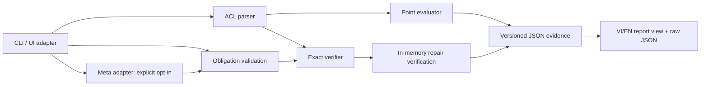

# Plenilune — kiến trúc

Ngày: 30/10/2026. Bản làm việc được rút gọn từ bản trong `Sơ khai/`; bản gốc giữ nguyên.
Trạng thái từng phần và lệnh chạy nằm tại [README](README.md).

## Sản phẩm và ranh giới

Hai ACL + ý định → tìm thay đổi hành vi → giải thích bằng packet/rule → đề xuất sửa → kiểm chứng bản sửa.
Go single binary, core stdlib, file-in/file-out. UI và Meta là adapter; không cần MoonStorm chạy.
Slice nền xử lý một named extended ACL trong file riêng, trace một packet, replay trace và chuẩn hóa obligation definitions.
Exact comparison, verified repair và replay đã có trong CLI/localhost API. Meta
tool loop đã chạy một ca live Contributor với engine/repair thật. Web UI gọi runtime
compare/session/repair/replay, mặc định VI, AI off và không giữ khóa ở browser.
Sample input là synthetic có nhãn; kết quả hiển thị là runtime. Báo cáo đã dịch là
view riêng; raw JSON là artifact gốc.
Thiết kế bước kế tiếp ở [product UX](docs/design/product-ux.md): khám phá delta
trước policy, canonical preview, quyết định review và hồ sơ replay độc lập.
Các slice D0–D4 đã implemented, không đổi deterministic core; endpoint preview
có authority tại CONTRACTS mục 7. New-flow browser QA cần chạy riêng.

## Chủ sở hữu code

| Package | Trách nhiệm | Không làm |
|---|---|---|
| `cmd/plenilune` | signal/context và exit | Logic ACL |
| `internal/cli` | flags, giới hạn đọc, orchestration, stdout/stderr | Quyết định semantics |
| `internal/ciscoacl` | Parse subset, source line, linear first-match evaluator | Network, file I/O, equivalence |
| `internal/intent` | Typed obligation, strict validation | Chứng nhận AI hiểu đúng ý định |
| `internal/evidence` | Trace/full comparison DTO và digest | Tự thay kết quả verifier |
| `internal/workflow` | Parse pair, compare/seal và semantic replay | Provider, file I/O |
| `internal/patch`, `internal/repair` | Pinned edits, frozen policy, collateral và repair replay | Device/file apply, provider |
| `internal/engineadapter`, `internal/orchestrate` | Agent ports, ownership, policy authority và session facade | Tự tạo verdict |
| `internal/jsonio` | Bounded strict JSON, reject duplicate/unknown fields | Quyết định domain semantics |
| `internal/packetset`, `internal/verify` | Exact algebra, witness, obligation checking | Provider, UI, SSH |
| `internal/ai`, `internal/agent` | Provider/tool loop, budget, evidence refs | Tự tạo verdict hoặc apply thiết bị |
| `internal/analysis` | Intake cấu hình, inventory đối tượng, dispatch domain, artifact phân tích và replay | Parse/semantics của miền; device/auth |
| `internal/prefixlist` | Parse/evaluate/compare IPv4 prefix-list chính xác | Network, file I/O, route-map |
| `internal/demohttp` | API localhost, opt-in Meta config/session | Quyết định semantics hoặc gọi device |

Không tạo package rỗng chỉ để khớp sơ đồ. Contract máy đọc và ví dụ có authority tại [CONTRACTS](CONTRACTS.md).

## Contract xuyên thành phần

- Input có role `before`/`after`, digest bytes, ACL identity; giữ nguyên chiều so sánh.
- Kết quả luôn ghi parser/semantics/engine version, scope, status và limitations.
- Point evaluation chứng minh quyết định cho một tuple trong mô hình; không chứng minh equivalence.
- Global verdict và từng obligation là hai kết quả độc lập. `EQUIVALENT` vẫn có thể đi cùng obligation `VIOLATED`.
- Canonical accepted obligation **definition** (kind, region, excludes, scope, ID) và kết quả đều thuộc deterministic digest, cùng input digests và phiên bản.
- Model ID, usage, response hash và timing là metadata riêng. AI không cần được gọi lại để replay deterministic evidence.
- Hash kiểm tra nội dung/consistency; không chứng minh người tạo, không chống kẻ sửa cả nội dung lẫn hash.
- Trace dùng `plenilune.trace/v1`; full comparison dùng `plenilune.evidence/v1`. Replay đọc đúng schema, không đổi nghĩa trace.
- JSON evidence là dữ liệu gốc cho view. Full replay dùng input + obligation đã lưu; checksum-only không được gọi là semantic replay.

## Tích hợp và lỗi

MoonStorm tương lai gọi subprocess JSON theo version đã pin; MoonStorm giữ auth, artifact identity, decrypt, audit và budgets.
Không copy/import code MoonStorm, không thêm coupling SQLite/custody/SSH vào core.
Lỗi có code/stage/source line khi biết; không in secrets hoặc cả config vào log.
Unsupported, input limit, ambiguity và budget không được biến thành kết luận an toàn.
Server demo chỉ listen localhost. Repo chưa push; license đã chốt GPL-3.0-only;
lượt này không gọi live Meta.

## Runtime update — 31/10/2026

Plenilune is no longer ACL-shaped at its edges. `internal/analysis` owns
configuration intake, object pairing, coverage accounting and the versioned
`plenilune.analysis/v2` artifact (v1 frozen, replay-only); ACL and prefix-list engines plug in as domains
with their own parsers, budgets and verdicts. UI, report and the subprocess JSON
client speak in objects and configuration versions; packet/rule vocabulary is
confined to ACL object views. Unsupported objects and unanalyzed configuration
are explicit and never become behavior verdicts. ACL v0.2 evidence and
`acl-repair/v0.2` are new; v0.1 remains replayable with its original accounting.

Runtime update — 30/10/2026

Policy preview uses `/api/policy/normalize`; the UI freezes canonical definitions
after explicit review. Candidate/edit revisions bind late verify/replay responses
and human decisions to the selected receipt. Manual and AI-session receipts are
displayed, received and exported only when their input pins, obligation digest
and full accepted policy hash match the accepted snapshot; foreign receipts fail
closed before a conclusion is offered. Export/import preserves original source
bytes; standalone offline replay does not need current UI state or Meta.
Provider transport is stateless Responses with encrypted reasoning replay only
in bounded process memory. See [current handoff](docs/handoff/contributor-runtime.md).

Prefix semantics/replay update31/10: parser/engine v0.2 pin a declared canonical
IPv4 model, while frozen v0.1 remains replay-only. The domain-neutral analysis
replay compares all non-timing data even if one ACL computation is time-limited;
no new service, schema or MoonStorm dependency. [Profile](docs/semantics/prefix-list-v02.md).
