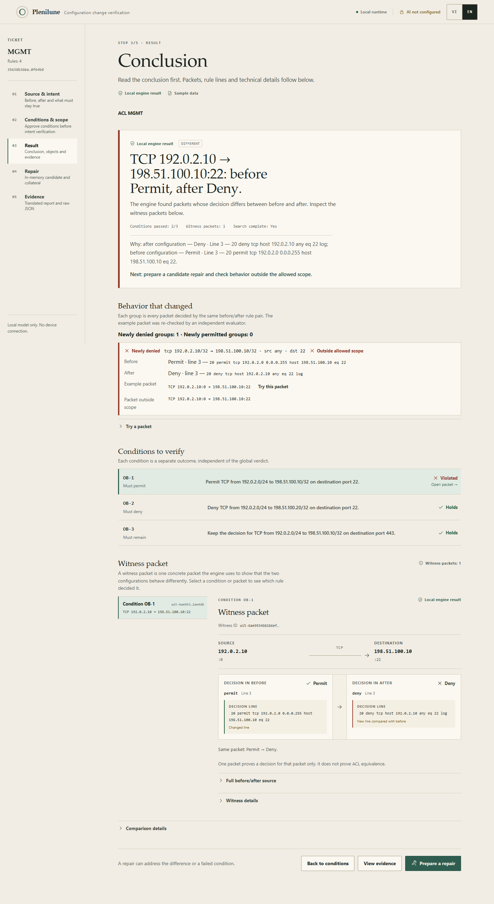

# Plenilune

Semantic diff and change-intent verification for network configuration: compare
two configuration versions, name which objects and behaviors changed, show a
re-evaluated witness, and hand over evidence another person can replay. ACL is
the first analysis domain; IPv4 prefix-lists are the second. Plenilune is an
independent Go project; a versioned JSON adapter is the future MoonStorm
integration boundary. No device is contacted.

Status (31 October 2026): configuration intake, a domain-neutral analysis
artifact, exact ACL and IPv4 prefix-list comparison, change classes, in-memory
ACL repair, offline replay, local review UI, Contributor provider adapter and
receipt-binding guards are implemented and locally tested. AI is opt-in and
locked to `muse-spark-1.3-contributor`; there is no fallback model. Offline UI
QA in Brave covers VI/EN, 320/390/1440 and the keyboard path; live UI,
real-device, screen-reader and model-quality qualification remain open. The
local runtime is not a hosted service.

Backend update 31 October: prefix-list parser/engine v0.2 now bind the declared
[semantics profile](docs/semantics/prefix-list-v02.md), validate exported IR and
source-order sequences, and preserve frozen v0.1 analysis replay. Timing-limited
ACL replay cannot excuse tampered prefix counts, source metadata or coverage.
Current checks and QA handoff: [backend-prefix-v02](docs/handoff/backend-prefix-v02.md).
The following UI/demo pass is recorded in
[demo-ui-public](docs/handoff/demo-ui-public.md).

## What it does

- Reads one full configuration (running-config/backup) or a standalone ACL,
  inventories supported objects with exact byte/line mapping, and explicitly
  lists unsupported and unanalyzed configuration. It never infers that an
  unanalyzed part is unchanged or safe.
- Analyzes two domains: Cisco IOS named extended IPv4 ACLs and IPv4
  `ip prefix-list` route filters. Other domains are reported, not guessed.
- Explains ACL differences as change classes: newly denied and newly permitted
  groups keyed by the deciding before/after rule, each with an independently
  re-evaluated example packet and, when an operator-accepted scope is supplied,
  an inside/outside-allowed classification.
- Compares prefix-lists exactly over every IPv4 route, reporting affected route
  counts, length sets, deciding sequence entries and a witness route.
- Lets the reviewer probe a neighboring packet against before, after and a
  candidate repair; a probe explains one point and is never called proof.
- Parses a documented subset of one named extended IPv4 ACL.
- Compares two ACLs over the complete modeled packet space and emits a witness
  when behavior differs; an inconclusive or unsupported search never becomes
  `EQUIVALENT` or `HOLDS`.
- Validates typed obligations and explains a packet decision with the exact
  rule/source line.
- Verifies a candidate repair against accepted obligations and the collateral
  outside the declared allowed-change scope — in memory only.
- Exports the exact source bytes and standalone Go-sealed receipts. A fresh
  session can replay them offline without AI.
- Shows a translated VI/EN report as a view; raw JSON remains the source
  artifact.

The engine owns verdicts. AI proposes conditions or in-memory edits but never
creates a proof. A packet trace is not an equivalence proof, a successful repair
does not authenticate its author, and the tool does not apply changes to a
device.

## Requirements

- Go 1.26 or newer; no external Go dependencies.
- Node.js 20+ and npm for the optional web UI.
- Windows is the current local demo environment; the Go core and CLI are
  portable.

## Quick start

```sh
go build -o bin/plenilune.exe ./cmd/plenilune
./bin/plenilune.exe version
./bin/plenilune.exe parse --config testdata/acl/management.acl
./bin/plenilune.exe trace --config testdata/acl/management.acl --packet testdata/packet.json
./bin/plenilune.exe obligations --file testdata/obligations.json
```

`analyze --before before.cfg --after after.cfg` (or `--request FILE|-` for
in-memory JSON input) emits `plenilune.analysis/v2`; `analyze-replay` reproduces
it offline from the original bytes. Artifacts carry no raw configuration text
outside the analyzed objects (v2 redaction); frozen `plenilune.analysis/v1`
artifacts remain replayable from their original sources. An independent client that only spawns the
binary and reads JSON lives in `examples/moonstorm-client/`.

For terminals and scripts, `diff --brief --out FILE` keeps the same sealed
evidence artifact (byte-identical JSON) but writes it to the named file and
prints a fixed five-line summary instead: the verdict (INCONCLUSIVE always
with its stop reason), the compared ACL's status line, the per-obligation
listing (`none evaluated` when no conditions were given), the modeled-scope
limitations line, and the artifact path. Brief exit codes are scriptable:
0 EQUIVALENT, 1 DIFFERENT, 2 INCONCLUSIVE, 3 any usage/parse/IO error, with
errors as a single line on stderr.

`scripts/demo.ps1` builds, traces, and replays the sample packet.
`scripts/demo-exact.ps1` exercises exact comparison and replay;
`scripts/demo-repair.ps1` exercises an in-memory repair and its receipt. All
sample data is synthetic.

The fixture denies SSH from `192.0.2.10` before a broader permit. A deny result
is a successful trace (exit 0). `verify` checks the digest and reruns that
packet; it does not claim two ACLs are equivalent.

## Walkthroughs and screenshots

Two synthetic, offline walkthroughs show the complete review path and its
limits:

1. **ACL drift** — unintended SSH deny → conditions/scope → in-memory repair →
   review decision → fresh-session replay.
2. **Prefix-list route change** — exact canonical route counts → model limits →
   fresh analysis replay.

Read the [English walkthrough](docs/walkthrough-en.md) or the
[Vietnamese walkthrough](docs/walkthrough-vi.md). Both label their synthetic
inputs and include the commands for independent replay.



More reviewed views: [VI result](docs/screenshots/vi-acl-result.png),
[repair and decision](docs/screenshots/en-acl-repair.png),
[prefix-list result](docs/screenshots/en-prefix-result.png),
[mobile 390 px](docs/screenshots/vi-mobile-result.png).

## Offline demo without a key

```sh
go build -o bin/plenilune.exe ./cmd/plenilune
go build -o bin/plenilune-demo.exe ./cmd/plenilune-demo
cd web
npm ci
npm run build
cd ..
./bin/plenilune-demo.exe -addr 127.0.0.1:8082 -web web/dist
```

Open `http://127.0.0.1:8082`. The runtime mark must read **Local runtime**;
the AI badge stays **AI off** unless you explicitly send a request and the
server process already has a key. No Meta request is made at startup. The
server listens on loopback only. `./scripts/start-local.ps1` offers the same
offline mode when its key box is left empty.

## Local review UI

After the build above, run the frontend tests and start the local UI:

```sh
cd web
npm test
cd ..
./scripts/start-local.ps1
```

The demo server listens on loopback (default `127.0.0.1:8082`). The UI workflow
is: open or paste both configuration versions (file import keeps exact bytes),
read the configuration overview, select an object, inspect change classes and
example packets, optionally probe a neighboring packet, author ACL conditions,
preview the canonical full policy, explicitly accept it, review a candidate,
record a human decision, and export/replay the evidence. A prefix-list object
shows its route-level result and states that intent/repair are not supported for
that domain yet.

The result plate answers three questions above the fold: what changed (the
witness packet and action change), why (the deciding rule in each version) and
what next (policy, repair, retry or evidence). Packet text, full source, rule
lines, hashes, budgets and raw JSON stay behind progressive disclosure so the
evidence remains available without dominating the first read.

AI is off by default. Enabling it requires an explicit UI consent action and a
key already present in the server process environment. The browser never
receives the key. Missing configuration is reported as `not_configured`; the
manual path remains available.

## Verification and evidence

- `gofmt`, `go vet`, ordinary tests, race tests and `go build`.
- Frontend unit tests and production build.
- Exact-byte export/import tests, canonical policy preview tests, revision
  guards for late responses, and provider mock tests (malformed/partial/refusal/
  timeout/rate-limit responses never become completed or verified).
- Receipt binding: manual and AI-session repair receipts are accepted only when
  their input hashes, obligation digest and full accepted policy hash match the
  current accepted snapshot. Foreign receipts are rejected before display,
  receipt, or export.
- Browser QA uses synthetic inputs and a separate no-key server; it does not
  treat a recorded backend session as a new live UI run. The 31 October pass ran
  142 checks in Brave 156.0.8078.80 (VI/EN, 320/390/1440, keyboard path, light
  and dark), with no serious/critical axe findings and no external request.
- Domain checks: exhaustive reduced-domain oracles for ACL change classes and
  prefix-list comparison; engine v0.2 is box-for-box equivalent to v0.1 on a
  fixed corpus and keeps v0.1 receipt replay. Measured latency and cost are
  recorded in `docs/research/` with the environment, not generalized from
  cache-warm runs.

Read [CONTRACTS](CONTRACTS.md) for wire schemas and [VERIFICATION_DESIGN](VERIFICATION_DESIGN.md)
for proof scope. [ARCHITECTURE](ARCHITECTURE.md) describes package ownership.
[AI_AGENT_DESIGN](AI_AGENT_DESIGN.md) describes the bounded provider/tool loop.
[ENGINEERING_GUARDRAILS](ENGINEERING_GUARDRAILS.md) lists change discipline.
[REVIEW_NOTES](REVIEW_NOTES.md) records prior review dispositions.
[ROADMAP](ROADMAP.md) lists remaining work. A Vietnamese walkthrough is in
[docs/usage-vi.md](docs/usage-vi.md). Historical implementation handoffs are in
`docs/handoff/`. Security model and reporting gaps: [SECURITY.md](SECURITY.md).
Dependency inventory: [THIRD_PARTY_NOTICES.md](THIRD_PARTY_NOTICES.md).

## Safety and data

Use synthetic ACLs, packets, obligations and receipts. Do not commit real
device configuration, credentials, API keys, captured traffic or customer
identifiers. The server reads `META_MODEL_API_KEY` from its own process
environment only when AI is explicitly enabled; it is never serialized into
receipts, session files or browser state. The provider model is fixed to
`muse-spark-1.3-contributor`; model override and fallback are rejected.

## License

Plenilune is licensed under the **GNU General Public License, version 3 only
(GPL-3.0-only)**. The full text is in [LICENSE](LICENSE); the project copyright
and license boundary are in [NOTICE](NOTICE). Copyright (C) 2026 Võ Mạnh Cường
(Chooky). Quorix Việt Nam is the project's brand.

The GPL permits commercial use, including paid services and distribution; it
does not prohibit competition. If you distribute Plenilune or a modified
version, GPL-3.0 requires you to comply with its terms, including providing the
corresponding source under GPL-3.0-only and preserving notices. No additional
restrictions and no "or later" option are added.

The license covers Plenilune's own source. Third-party components keep their
own licenses; see [THIRD_PARTY_NOTICES.md](THIRD_PARTY_NOTICES.md) and
`third_party/licenses/`. Meta's model and API are a separate service governed
by Meta's terms; they are not licensed or relicensed under Plenilune's GPL.
Plenilune is independent and is not affiliated with or endorsed by Meta, Cisco
or the MoonStorm project.

Publication preparation is described in the curated
[public catalog](docs/public-catalog.md). The snapshot and local checks are the
review artifact; remote publication is an owner action. Report vulnerabilities
privately to **chooky@quorix.io.vn**; see [SECURITY.md](SECURITY.md). Research
originals in `Sơ khai/`, local `out/`/`bin/` artifacts, web build output, and QA
evidence are not publication inputs.
