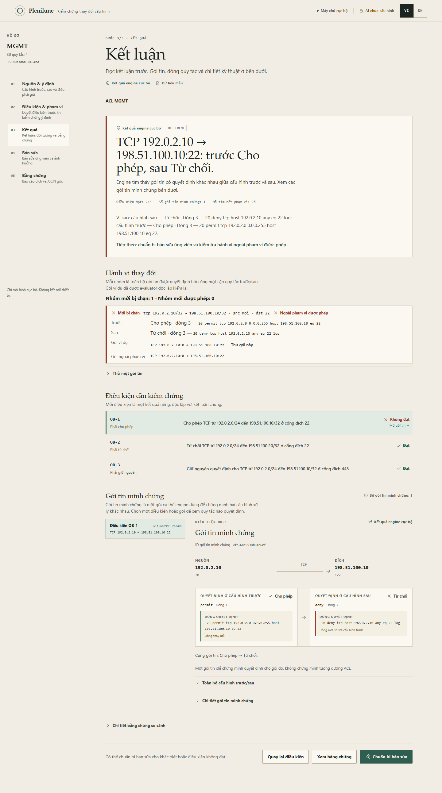

# Plenilune

Semantic diff và kiểm chứng ý định thay đổi cho cấu hình mạng: so sánh hai phiên
bản cấu hình, chỉ rõ đối tượng và hành vi nào đổi, đưa witness đã được kiểm lại,
và bàn giao bằng chứng để người khác replay. ACL là miền phân tích đầu tiên;
IPv4 prefix-list là miền thứ hai, và ACL IPv4 standard, object-group cùng so
sánh ACL IPv6 đã được phát hành sau đó (xem Trạng thái). Đây là dự án Go độc
lập; adapter JSON có phiên bản (subprocess + JSON, kèm client mẫu ở
`examples/moonstorm-client/`) là ranh giới tích hợp MoonStorm. Không kết nối
tới thiết bị.

Trạng thái (05/11/2026): phiên bản 1.0.0. Intake cấu hình, artifact phân tích
trung lập miền, so sánh chính xác ACL và IPv4 prefix-list, change class, sửa
ACL trong bộ nhớ, replay offline, giao diện review cục bộ, adapter Contributor
và guard bind receipt đã được triển khai và kiểm tra. Breadth của Phase 3 đã
vào: ACL IPv4 standard, object-group trong named extended IPv4 ACL, so sánh
ACL IPv6, và thư viện obligation CIS dạng dữ liệu ở `examples/cis/`. Route-map
và vendor thứ hai hoãn theo quyết định của chủ dự án. Nghiệm thu đóng ở mức
PARTIAL: live UI và một lượt NVDA có bằng chứng trong phạm vi đã ghi ở
[docs/qualification-p3a.md](docs/qualification-p3a.md); điều kiện do AI đề xuất
dùng được 0/3 lượt đã ghi, và chưa có thiết bị vật lý nào được nghiệm thu. AI
chỉ bật khi người dùng chọn và bị khóa ở `muse-spark-1.3-contributor`; không
có model dự phòng. Runtime cục bộ không phải dịch vụ hosted.

Parser/engine prefix-list v0.2 ràng buộc theo
[profile semantics](docs/semantics/prefix-list-v02.md) đã tuyên bố, validate IR
đã xuất và sequence theo thứ tự nguồn, và giữ replay của artifact v0.1 đã đóng
băng. Replay ACL bị giới hạn thời gian không thể bỏ qua việc prefix count,
metadata nguồn hoặc coverage bị sửa.

Bàn review cục bộ ưu tiên kết quả có sẵn, dùng hệ màu cream/beige sáng với điểm
nhấn olive trầm, và gập watch tùy chọn cùng việc sửa policy. Xem
[design và QA](docs/design/qa/review-desk.md) để biết các kiểm tra và tiêu chí
duyệt hình ảnh còn mở; chữ ký duyệt hình ảnh của chủ dự án vẫn còn chờ tại đó.
Ảnh walkthrough lịch sử bên dưới có trước thiết kế này.

## Chức năng

- Đọc một cấu hình đầy đủ (running-config/backup) hoặc một ACL riêng, lập danh
  mục đối tượng được hỗ trợ với mapping byte/dòng chính xác, và liệt kê rõ phần
  unsupported/chưa phân tích. Không suy phần chưa phân tích là không đổi/an toàn.
- Các miền phân tích: named extended IPv4 ACL của Cisco IOS — gồm cả rule tham
  chiếu object-group network và service — ACL IPv4 standard (dạng named và
  dạng numbered), ACL IPv6, và route filter IPv4 `ip prefix-list`. Miền khác
  được ghi nhận, không đoán. Độ sâu khác nhau theo miền: so sánh IPv6 chỉ báo
  verdict và witness (chưa có change class, obligation hay repair ở phiên bản
  này), và prefix-list chưa có đường intent/repair.
- Giải thích khác biệt ACL thành change class: nhóm mới bị chặn/mới được phép
  theo cặp quy tắc quyết định trước/sau, mỗi nhóm có gói ví dụ đã được evaluator
  kiểm lại; khi có policy đã duyệt, gắn phân loại trong/ngoài phạm vi.
- So sánh prefix-list chính xác trên toàn bộ route IPv4: số route bị ảnh hưởng,
  độ dài, entry quyết định và route ví dụ.
- Audit chính xác một ACL IPv4 (`audit`): rule không tới được và rule dư thừa
  từ vùng hiệu lực lũy kế, cộng quan hệ generalization/correlation dạng
  heuristic. Audit chỉ báo cáo, không bao giờ sửa cấu hình.
- Thư viện obligation CIS dạng dữ liệu ở `examples/cis/`: bốn bộ obligation có
  sẵn ở định dạng `plenilune.obligations/v1`, cắm thẳng vào policy không cần
  sửa. Không phân phối lại văn bản benchmark CIS; xem
  [docs/cis-obligation-library.md](docs/cis-obligation-library.md) để biết phần
  nào được encode và phần nào không.
- Cho phép thử gói lân cận trên before/after/candidate; probe chỉ giải thích một
  điểm, không phải proof.
- Parse một tập con được mô tả của một named extended IPv4 ACL.
- So sánh hai ACL trên toàn bộ không gian gói tin trong mô hình và phát witness
  khi hành vi khác nhau; tìm kiếm inconclusive/unsupported không bao giờ thành
  `EQUIVALENT` hoặc `HOLDS`.
- Validate obligation có kiểu và giải thích quyết định gói tin bằng đúng quy tắc
  và dòng nguồn.
- Kiểm chứng candidate trong bộ nhớ theo obligation đã duyệt và vùng collateral
  ngoài phạm vi thay đổi được phép.
- Xuất đúng byte nguồn và receipt độc lập do Go seal; phiên sạch có thể replay
  offline, không cần AI.
- Báo cáo VI/EN đã dịch chỉ là view; JSON gốc vẫn là artifact nguồn.

Engine sở hữu kết luận. AI chỉ đề xuất điều kiện hoặc chỉnh sửa trong bộ nhớ,
không tạo proof. Một packet trace không phải chứng minh tương đương; bản sửa
thành công không xác thực tác giả; công cụ không áp dụng thay đổi lên thiết bị.

## Yêu cầu

- Go 1.26 trở lên; không có dependency Go bên ngoài.
- Node.js 20.19+ (hoặc 22.12+) và npm cho web UI tùy chọn.
- Windows là môi trường demo cục bộ hiện tại; Go core và CLI dùng được đa nền tảng.

## Bắt đầu nhanh

```sh
go build -o bin/plenilune.exe ./cmd/plenilune
./bin/plenilune.exe version
./bin/plenilune.exe parse --config testdata/acl/management.acl
./bin/plenilune.exe trace --config testdata/acl/management.acl --packet testdata/packet.json
./bin/plenilune.exe obligations --file testdata/obligations.json
```

`analyze --before before.cfg --after after.cfg` (hoặc `--request FILE|-` cho JSON
trong bộ nhớ) xuất `plenilune.analysis/v3`; một cặp chạy được có sẵn trong cây:
`./bin/plenilune.exe analyze --before testdata/configs/intended/before.cfg
--after testdata/configs/intended/after.cfg`. `analyze-replay` tái lập offline
từ đúng byte gốc. Artifact không chứa nguyên văn cấu hình ngoài các object đã
phân tích (redaction đưa vào ở v2, giữ ở v3); artifact
`plenilune.analysis/v1` và `/v2` đã đóng băng vẫn replay được từ source gốc.
Client độc lập chỉ gọi binary và đọc JSON nằm ở `examples/moonstorm-client/`.

Cùng binary đó còn có `capabilities`, `diff`, `audit` / `audit-replay`,
`bundle-export` / `bundle-replay`, `repair-enumerate` và các lệnh Ed25519
`sign` / `verify-signature`; `plenilune --help` liệt kê mọi lệnh và mã thoát
của chúng. Chỉ `assist --ai on` mới có thể gọi Meta; mọi lệnh còn lại đều
offline.

Với terminal và script, `diff --brief --out FILE` giữ nguyên artifact bằng
chứng đã seal (JSON giống hệt từng byte) nhưng ghi vào file được chỉ định và
in tóm tắt cố định năm dòng: verdict (INCONCLUSIVE luôn kèm lý do dừng), dòng
trạng thái của ACL được so sánh, danh sách từng obligation (`none evaluated`
khi không có điều kiện), dòng giới hạn phạm vi mô hình, và đường dẫn artifact.
Mã thoát của brief dùng được cho script: 0 EQUIVALENT, 1 DIFFERENT,
2 INCONCLUSIVE, 3 mọi lỗi usage/parse/IO, với lỗi là một dòng duy nhất trên
stderr.

`scripts/demo.ps1` build, trace và replay gói mẫu. `scripts/demo-exact.ps1`
kiểm tra so sánh chính xác và replay; `scripts/demo-repair.ps1` kiểm tra bản sửa
trong bộ nhớ và receipt. Mọi dữ liệu mẫu là synthetic.

Fixture cố ý deny SSH từ `192.0.2.10` trước một permit rộng hơn. Kết quả deny là
trace thành công (exit 0). `verify` kiểm tra digest và chạy lại đúng gói đó;
không tuyên bố hai ACL tương đương.

## Walkthrough và ảnh chụp

Hai walkthrough synthetic, chạy offline, đi hết đường review và nêu rõ giới hạn:

1. **ACL đổi ngoài ý muốn** — SSH bị chặn → điều kiện/phạm vi → sửa trong bộ nhớ
   → quyết định review → replay trong phiên sạch.
2. **Prefix-list đổi vùng route** — số route canonical chính xác → giới hạn mô
   hình → replay hồ sơ phân tích trong phiên sạch.

Đọc [walkthrough tiếng Việt](docs/walkthrough-vi.md) hoặc
[walkthrough tiếng Anh](docs/walkthrough-en.md). Cả hai ghi rõ dữ liệu synthetic
và lệnh replay độc lập.



Ảnh đã soát khác: [bản sửa và quyết định](docs/screenshots/vi-acl-repair.png),
[kết quả prefix-list](docs/screenshots/vi-prefix-result.png),
[mobile 390 px](docs/screenshots/vi-mobile-result.png).

## Demo offline không key

```sh
go build -o bin/plenilune.exe ./cmd/plenilune
go build -o bin/plenilune-demo.exe ./cmd/plenilune-demo
cd web
npm ci
npm run build
cd ..
./bin/plenilune-demo.exe -addr 127.0.0.1:8082 -web web/dist
```

Mở `http://127.0.0.1:8082`. Trạng thái phải là **Máy chủ cục bộ**; badge AI giữ
**AI tắt** trừ khi bạn chủ động gửi yêu cầu và process server đã có key. Không có
request Meta nào lúc khởi động. Server chỉ nghe loopback.
`./scripts/start-local.ps1` cho cùng chế độ offline khi để trống ô key.

## Giao diện review cục bộ

Sau khi build ở trên, chạy test frontend và mở UI:

```sh
cd web
npm test
cd ..
```

Trên Windows, `./scripts/start-local.ps1` là launcher thay cho việc chạy trực
tiếp demo binary: nó hỏi Meta key và chỉ đưa key vào process của server (để
trống ô key để chạy offline) và mở UI trong trình duyệt khi tìm thấy.

Demo server chỉ nghe loopback (mặc định `127.0.0.1:8082`). UI mở ở luồng nhanh
verdict-first; luồng review đầy đủ là: mở hoặc dán
hai phiên bản cấu hình (import giữ nguyên byte), đọc tổng quan, chọn đối tượng,
xem change class và gói ví dụ, thử gói lân cận, tự soạn điều kiện ACL, xem trước
toàn bộ policy canonical, chấp nhận rõ ràng, review candidate, ghi quyết định và
xuất/replay bằng chứng. Prefix-list hiển thị kết quả theo route và nêu rõ
intent/repair chưa hỗ trợ cho miền đó. Đối tượng IPv6 hiển thị verdict so sánh
và witness của nó; obligation và repair chưa hỗ trợ cho IPv6 ở phiên bản này.

Phiếu kết quả trả lời ba câu ngay phần đầu: đổi gì (witness và chiều hành vi),
vì sao (quy tắc quyết định ở mỗi bản) và làm gì tiếp (policy, bản sửa, thử lại
hoặc bằng chứng). Văn bản packet, toàn bộ nguồn, số dòng, hash, ngân sách và
JSON gốc nằm trong phần mở rộng để bằng chứng vẫn còn nhưng không lấn phần đọc
chính.

AI tắt mặc định. Bật AI cần thao tác đồng ý rõ ràng trên UI và key đã có trong
process environment của server. Browser không nhận key. Thiếu cấu hình trả
`not_configured`; đường thủ công vẫn dùng được.

## Kiểm chứng và bằng chứng

- `gofmt`, `go vet`, test thường, test race và `go build`.
- Unit test frontend và production build.
- Test export/import đúng byte, preview policy canonical, guard response trễ và
  provider mock (malformed/partial/refusal/timeout/rate-limit không thành
  completed/verified).
- Bind receipt: receipt sửa thủ công và từ AI session chỉ được chấp nhận khi
  input hash, obligation digest và full accepted policy hash khớp snapshot đã
  duyệt. Receipt lạ bị từ chối trước khi hiển thị, nhận hoặc xuất.
- Chữ ký Ed25519 tách rời (`plenilune.signature/v1`) là tùy chọn và ràng buộc
  cả hai digest của một artifact đã seal. Chữ ký chỉ chứng thực việc nắm giữ
  khóa: hash không phải chữ ký, và chữ ký không bao giờ thay đổi verdict hay
  kết quả replay.
- Brave QA dùng dữ liệu synthetic và server no-key riêng; không coi session
  backend đã ghi là một lượt live UI mới. Lượt 31/10 chạy 142 kiểm tra trong
  Brave 156.0.8078.80 (VI/EN, 320/390/1440, đường bàn phím, light/dark), không
  có vi phạm axe serious/critical và không có request ra ngoài loopback.
- Kiểm miền: oracle exhaustive reduced-domain cho change class ACL và prefix-list,
  và oracle vi phân Z3 chạy trong CI cho engine ACL
  ([docs/oracle-z3.md](docs/oracle-z3.md)); artifact các phiên bản cũ đã đóng
  băng vẫn replay được. Số đo latency/chi phí ở `docs/research/` kèm môi
  trường, không suy rộng từ cache nóng.

Đọc [CONTRACTS](CONTRACTS.md) cho wire schema và [VERIFICATION_DESIGN](VERIFICATION_DESIGN.md)
cho phạm vi proof. [ARCHITECTURE](ARCHITECTURE.md) mô tả ownership package.
[AI_AGENT_DESIGN](AI_AGENT_DESIGN.md) mô tả provider/tool loop có giới hạn.
[ENGINEERING_GUARDRAILS](ENGINEERING_GUARDRAILS.md) là quy tắc thay đổi.
[REVIEW_NOTES](REVIEW_NOTES.md) ghi disposition review trước đó.
[ROADMAP](ROADMAP.md) liệt kê việc còn lại. Hướng dẫn sử dụng tiếng Việt ở
[docs/usage-vi.md](docs/usage-vi.md). Handoff triển khai lịch sử nằm trong
local handoff notes. Mô hình bảo mật và khoảng trống báo lỗi:
[SECURITY.md](SECURITY.md). Inventory dependency:
[THIRD_PARTY_NOTICES.md](THIRD_PARTY_NOTICES.md).

## An toàn và dữ liệu

Chỉ dùng ACL, packet, obligation và receipt synthetic. Không commit cấu hình
thiết bị thật, credential, API key, traffic capture hoặc định danh khách hàng.
Server chỉ đọc `META_MODEL_API_KEY` từ process environment khi AI được bật rõ
ràng; key không được serialize vào receipt, session file hay browser state.
Model provider cố định `muse-spark-1.3-contributor`; override/fallback bị từ chối.

## Giấy phép

Plenilune được phát hành theo **Apache License, phiên bản 2.0
(Apache-2.0)**. Toàn văn ở [LICENSE](LICENSE); thông báo bản quyền và ranh giới
giấy phép ở [NOTICE](NOTICE). Bản quyền (C) 2026 Võ Mạnh Cường (Chooky). Quorix
Việt Nam là thương hiệu của dự án.

Apache License cho phép sử dụng, sửa đổi và phân phối, kể cả dịch vụ trả phí
và phân phối thương mại; giấy phép không cấm cạnh tranh. Nếu phân phối
Plenilune hoặc bản sửa đổi, bạn phải tuân thủ Apache License, gồm đính kèm
bản sao giấy phép cho người nhận và giữ các thông báo bản quyền, ghi công.
Giấy phép không cấp quyền thương hiệu. (Trước ngày 04/11/2026 dự án phát
hành theo GPL-3.0-only; các bản đã nhận theo GPL giữ nguyên điều khoản đó.)

Giấy phép chỉ áp dụng cho mã nguồn của Plenilune. Thành phần bên thứ ba giữ
giấy phép riêng; xem [THIRD_PARTY_NOTICES.md](THIRD_PARTY_NOTICES.md) và
`third_party/licenses/`. Model và API của Meta là dịch vụ riêng theo điều khoản
của Meta; không được cấp phép hoặc cấp phép lại theo Apache License của
Plenilune. Plenilune
độc lập, không liên kết và không được Meta, Cisco hay dự án MoonStorm bảo trợ.

Chuẩn bị public được mô tả ở [danh mục public](docs/public-catalog.md). Snapshot
và các kiểm tra cục bộ là artifact review; việc public remote là hành động của
chủ dự án. Báo cáo lỗ hổng bảo mật riêng tới **chooky@quorix.io.vn**; xem
[SECURITY.md](SECURITY.md). Research gốc trong `Sơ khai/`, artifact cục bộ
`out/`/`bin/`, build output web và QA evidence không phải đầu vào public.
