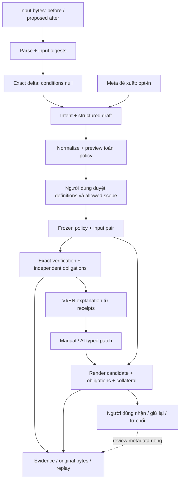
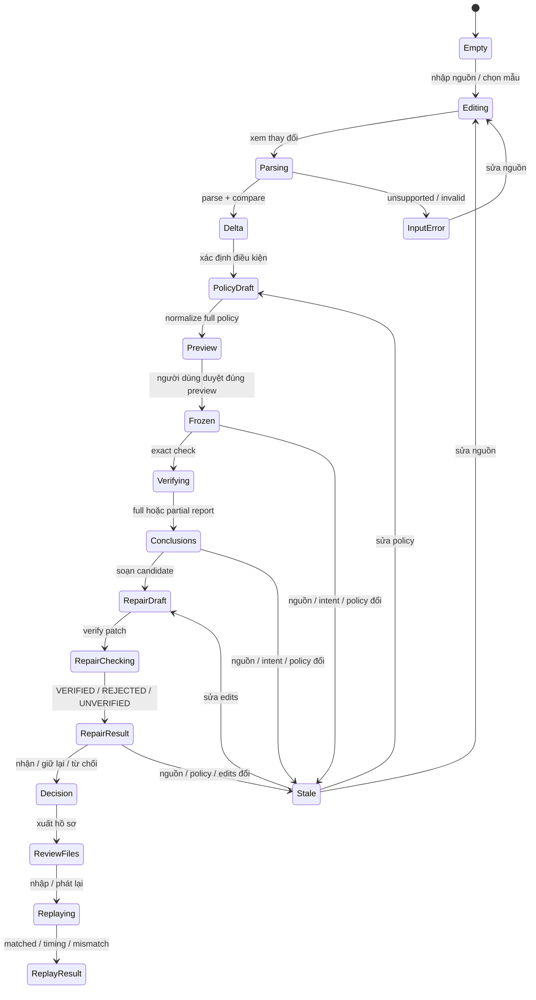

# Plenilune — từ thay đổi ACL đến quyết định nhận bản sửa

> Snapshot thiết kế trước triển khai; D0–D4 đã được thực hiện sau đó. Trạng thái và kiểm tra hiện hành: [README](../../README.md) / [handoff](../handoff/contributor-runtime.md).
Ngày 30/10/2026. **Thiết kế bước tiếp theo, chưa triển khai runtime.**
Tài liệu này sở hữu UX/hành trình; wire contract thuộc [CONTRACTS](../../CONTRACTS.md),
package thuộc [ARCHITECTURE](../../ARCHITECTURE.md), nghĩa chứng minh thuộc
[VERIFICATION_DESIGN](../../VERIFICATION_DESIGN.md), AI thuộc
[AI_AGENT_DESIGN](../../AI_AGENT_DESIGN.md). [Handoff triển khai](../handoff/product-ux-next.md).

## 1. Quyết định và baseline độc lập

Người dùng chính: **kỹ sư mạng review thay đổi ACL trước khi nhận vào change
ticket**. Người thứ hai: đồng nghiệp kiểm tra lại. Công việc quan trọng nhất là
biết thay đổi có làm hỏng truy cập cần giữ không, rồi quyết định có nhận candidate
thay cho bản đề xuất lỗi không. “Nhận” là quyết định review, chưa áp dụng thiết bị.

Chọn **phiếu duyệt thay đổi gắn với điều kiện đã duyệt và bằng chứng** làm hướng
chủ đạo. Cho xem hành vi thay đổi trước khi viết policy; kết thúc bằng quyết định
của người dùng và hồ sơ người khác chạy lại được. Giữ Go binary, React/Vite và
deterministic core; không thêm service/database/queue/plugin system. Chưa mở rộng
grammar/vendor hay xếp hạng “best repair” bằng AI. Tradeoff: người dùng phải duyệt
phạm vi cụ thể; đổi lại, kết luận có nghĩa rõ và demo không phụ thuộc provider.

Đã đối chiếu root owners, backend-repair, frontend/Meta handoff và implementation:

| Trạng thái | Căn cứ và giới hạn |
|---|---|
| Implemented | `web/src/lib/api.ts:runtime`, `hooks/useReview.ts` gọi parse/normalize/compare/session/repair/replay thật. `samples.ts` là **input synthetic**, không phải fixture verdict trong UI hiện tại. |
| Implemented | `repair.Verify/Replay`, `workflow.Replay`: obligations, collateral toàn vùng, receipts, semantic replay; `NormalizePolicy` giữ nil khác `[]`. VI/EN dùng dictionary, report là view, raw response được giữ. |
| Implemented nhưng chưa đủ | Source/policy generation guard và cancel đã có; revision của manual edits chưa được bảo vệ đầy đủ (§7). Có structured fields nhưng acceptance xảy ra trước normalization. |
| Chưa kiểm chứng live | `orchestrate/session_test.go:TestHTTPProviderAdapterAndRealRepairEndToEnd` dùng mock HTTP với engine thật; UI completed test mock runtime; QA `web/docs/qa/redesign-2026-10-30/REPORT.md` ghi no-key. Không suy live Muse đã đạt từ wiring/key presence. |
| Proposed | Delta trước policy, canonical full-policy preview, phiếu quyết định, candidate revision guard, xuất/nhập hồ sơ review độc lập. |

Đích demo vài ngày: synthetic SSH → điều kiện duyệt rõ → candidate VERIFIED →
replay trong phiên sạch bằng đường offline/manual. Live Muse là qualification
riêng; nếu chưa đạt, nói đúng trạng thái. Chỉ `muse-spark-1.3`, không fallback
model khác. Tài liệu này không gọi live, đọc key/clipboard hay đổi server.

## 2. Hành trình từ nhận nguồn tới quyết định

| Bước / cần biết | Hành động chính và đầu ra | Lỗi và phục hồi |
|---|---|---|
| **Nguồn:** đâu là trước thay đổi, đâu là đề xuất; một named extended ACL, digest bytes, mẫu hay tự nhập? | **Xem hành vi thay đổi**: parse hai bên, exact compare `conditions:null`; intent có thể thêm sau. | Sai grammar/ACL identity: chỉ side/line, giữ input. Không cắt dòng unsupported để chạy tiếp. Chỉ hai nguồn bắt buộc để khám phá. |
| **Delta:** packet nào permit→deny/deny→permit, rule đầu tiên nào quyết định? | **Xác định điều cần giữ/đổi**: summary, witness, linked rules; intent ticket nằm cạnh. | Hết budget: giữ witness recheck, ghi thiếu completeness. Retry defaults nếu đã hạ cap; không witness không đồng nghĩa không đổi. |
| **Duyệt ý định:** nguồn/đích/port/ngoại lệ, universe của “chỉ”, thay đổi được phép ở đâu? | **Duyệt điều kiện & đóng băng**, sau canonical preview: immutable input pair + conditions + allowed scope. | AI hỏi lại: sửa fields/intent rồi request mới. CIDR/port lỗi: sửa tại field. Mâu thuẫn không được tự bỏ condition; chưa rõ scope thì chưa nhận repair. |
| **Kiểm chứng:** đạt điều kiện nào, bằng chứng/giới hạn nào? | **Chuẩn bị bản sửa** nếu vi phạm, hoặc chuyển review: global và từng obligation độc lập. | AI lỗi không xóa exact result. INCONCLUSIVE không phải đạt; sửa input/policy hoặc retry có lý do, không auto loop. |
| **Candidate:** sửa violation gì, ngoài vùng cho phép còn giữ hành vi gốc không? | **Kiểm chứng bản sửa**, rồi **Nhận candidate để review**: bytes/hash, all HOLDS, collateral VERIFIED; quyết định người dùng riêng. | REJECTED: chỉ obligation/collateral witness. UNVERIFIED: thiếu scope/acceptance/budget. Giữ base/draft; edit mới tạo revision và chạy lại. |
| **Bàn giao:** đồng nghiệp tái lập được gì? | **Xuất hồ sơ kiểm tra lại**: exact source bytes + receipts + hướng dẫn; fresh session replay AI off. | Sai bytes/version/hash: lấy đúng input/build, không sửa proof cho khớp. TIMING_SENSITIVE không gọi là full replay matched. |

Phiếu phải trả lời ngay năm câu:

1. **Hành vi đổi thế nào?** Packet witness, action trước/sau, rule quyết định; số witness không đo toàn vùng ảnh hưởng.
2. **Đúng ý định không?** Outcome từng điều kiện đã duyệt; phần ticket chưa mã hóa ghi “chưa được kiểm chứng”.
3. **Bằng chứng/giới hạn?** Receipt, scope, search/budget, source refs; AI confidence không phải điểm an toàn.
4. **Sửa gì và ảnh hưởng ngoài phạm vi?** Violation nào được giải quyết; collateral so **original-before → candidate** ngoài allowed union.
5. **Kiểm tra lại thế nào?** Original bytes và receipt đúng loại, replay với version tương thích; hash không chứng minh tác giả/người phê duyệt.

## 3. Ba cải tiến có ích

| Đề xuất / tình huống | Giá trị so với hiện tại | Phụ thuộc, chi phí, tradeoff | Nghiệm thu |
|---|---|---|---|
| **1. Phiếu duyệt điều kiện — chủ đạo.** Nhận ticket “giữ SSH” nhưng chưa biết rule mới làm hỏng gì. | Delta trước policy; canonical readback cạnh ticket; kết luận hành vi cụ thể, điều kiện/scope và quyết định cùng một phiếu. Hiện structured fields đã có nhưng headline generic và approve trước normalize. | Chi phí vừa: UI/state/report + một adapter normalize full policy (§4). Một candidate trước; hoãn chat tự do, đa vendor, “AI approve”. Người dùng vẫn duyệt universe/ngoại lệ. | Workspace trống, hai ACL đủ xem delta; preview đúng definitions sẽ hash; sửa scope mất acceptance; người review giải thích được packet đổi, violation, giới hạn và lý do nhận mà không đọc JSON. |
| **2. Thử packet trên ba phiên bản.** Hỏi “host lân cận hoặc cổng 443 có bị ảnh hưởng không?”. | Từ witness sửa một field, thấy before / proposed-after / candidate và matched rule; hiện chỉ xem witness có sẵn. Khuyến khích đặt câu hỏi, không giả số ví dụ là coverage. | Chi phí nhỏ–vừa: thêm client/UI cho `/api/trace` đã có, 2–3 request cùng packet revision, không engine mới. Packet editor tự do để sau demo. | Thử .10→.11, 22→443 cho trace thật; late response không lẫn packet; nhãn “chỉ packet này”, không đổi global/obligation status. Candidate chưa có để trống cột ba. |
| **3. Hồ sơ review phát lại độc lập.** Đồng nghiệp không có phiên browser ban đầu. | Export đủ bytes/receipt/hướng dẫn; import review mode. Hiện tải JSON/report riêng và replay dựa state đang mở. | Chi phí vừa cho byte preservation/import cap; reuse replay v1. Demo tải file riêng có tên rõ, không ZIP/dependency mới, kho artifact hay audit identity. | Fresh session, AI off: đúng nguồn/receipt → matched; đổi CRLF/byte → mismatch; receipt REJECTED replay thành công vẫn REJECTED. Report dịch không cần cho replay. |

Không làm topology 3D, AI risk score, auto-apply hay “đúng ý hoàn toàn”. Sau demo
mới cân nhắc so hai candidate cùng inputs/policy/options; không chọn tự động theo
số edit ít nhất.

## 4. Kiến trúc, ownership và ranh giới tin cậy



| Owner | Dữ liệu/quyết định | API hiện có / thiếu thật |
|---|---|---|
| UI `SourceStep/useReview` | Draft bytes, role trước/sau, origin/revisions; không evaluate ACL | `/api/parse`, `/api/compare` nhận null conditions. Thiếu nhánh UI khám phá không intent/acceptance. |
| `intent`, `repair/policy.go`, HTTP adapter | Normalize/validity/digest toàn policy; acceptance **caller cung cấp** | `/api/obligations/normalize` chỉ conditions. Đề xuất một endpoint `/api/policy/normalize`, CONTRACTS §7; reuse core functions. |
| `agent/ai/orchestrate/engineadapter` | AI proposals, budgets/provenance/evidence refs; immutable policy authority trong request | `/api/agent/session` là synchronous POST, mỗi lần Engine mới; không continuation, history, stream hay persisted approval. Human review rồi repair là request mới. |
| `workflow/verify/packetset/ciscoacl` | Global/obligation verdict, witness/source binding, scope/limits | `/api/compare`, `/api/trace`; parser/verifier không file/network/device I/O. |
| `patch/repair` | Atomic render, immutable base refs, candidate/checks/collateral | `/api/repair/verify`: add_before/append/remove/replace, ≤5 edits; không cần đổi patch v1. |
| `evidence/workflow/repair.Replay` | Hash, semantic replay, bind definitions + results | compare/replay và repair/replay đã có; thiếu import UX và source-byte export, không thiếu verifier mới. |
| Presentation `i18n/report` | Câu đọc được, locale, local user decision; không verdict | Report là view, không tạo proof DTO frontend. |

**Preview/freeze proposed:** soạn → normalize full policy acceptance false →
hiện canonical readback và normalization diff (host bits, merged ports/excludes) →
người dùng duyệt → normalize cùng policy acceptance true → kiểm toàn policy
canonical vẫn đúng preview → snapshot immutable, compare. Hai P tất nhiên khác
do acceptance đổi: so toàn object sau khi đặt riêng operator_accepted=false ở cả
hai; gồm schema/scope/conditions/allowed_changes và giữ nil khác []. Không chỉ so
C hay scope ID. Bất kỳ field khác hoặc draft/generation đổi giữa chừng
thì bỏ response, duyệt lại. Endpoint không tự accept/lưu approval: bool hiện là
lời khai caller trong localhost trust model, không chữ ký hay authenticated ledger.
“Chỉ X được Y” phải có cả permit X và deny phần còn lại trong universe người dùng
xác định; thiếu universe không freeze. Schema-valid không chứng minh intent fidelity.

### Identity, policy version và invalidation

- **B/A:** digest exact bytes + ACL identity trước/sau, chiều cố định. File import
  giữ raw UTF-8 bytes riêng với textarea view, decode strict; sửa text tạo bytes
  revision mới và bỏ binding replay file cũ. Không normalize newline khi
  export/replay. Browser textarea có thể làm mất CRLF;
  không hứa replay file gốc nếu chỉ giữ textarea. Synthetic text hiện tại vẫn có
  identity là đúng bytes browser gửi.
- **C:** digest normalized Set (schema/scope/ID/kind/regions/excludes/ports).
  **P:** full normalized PolicyDigest, thêm acceptance và allowed scope. Policy
  v1 là schema, không phải revision nội dung; P1/P2 là nhãn revision UI, full hash
  mới là content identity.
- Compare identity: `(B,A,C hoặc null, parser/engine/scope,options)`. Receipt bind
  inputs/definitions/results/options, không bind full repair policy hay chứng nhận
  human approval. Session comparison có thể thuộc AI-proposed conditions; luôn
  render đúng definitions trong chính receipt, tách nhãn accepted.
- Patch v1 pin B/A/C/scope, refs `{base_after_sha256,ordinal,line}`, chưa pin P.
  Repair chở full frozen policy; receipt bind P + patch + candidate bytes/hash K +
  checks/options. UI khóa `(B,A,P,editRevision)`; C giống nhau không cho tái dùng
  receipt khi allowed scope đổi.
- Artifact identity là schema + hash; witness ID nằm trong receipt của nó.
  Delta `conditions:null` và approved comparison là hai artifact riêng.

| Thay đổi | Giá trị còn lại của kết quả cũ | UI bắt buộc |
|---|---|---|
| Source bytes/role/ACL identity | Đúng cho nguồn cũ | Abort, generation mới; parse/delta/acceptance/repair/replay hết current. |
| Intent text | Toán học vẫn đúng với definitions cũ, liên kết ý định cần duyệt lại | Mất acceptance và decision/repair current; giữ snapshot cũ read-only. |
| Conditions/excludes/scope/allowed_changes/acceptance | Không chứng minh policy mới; delta có thể giữ nếu B/A không đổi | Preview lại; invalidate approved comparison/repair/replay/decision. |
| Edit draft/chọn candidate khác | Receipt chỉ đúng revision cũ | Abort verify/replay, tăng candidate revision, bỏ current receipt/replay/decision. |
| Budget/options/parser/engine version | Artifact lịch sử giữ nguyên | New run/new artifact; replay dùng original options/version, không tự migrate. |
| VI↔EN/mở details/chọn witness | Không đổi validity | Chỉ view, zero engine/AI requests; bytes/hash giữ nguyên. |

Giữ một last sealed snapshot trong memory để thấy “kết quả phiên P1; đang sửa P2”.
Stale không có nút nhận cho draft hiện tại; export stale phải mang nhãn nguồn cũ.
Không cần history DB; reload bằng file, không lưu ACL vào localStorage (chỉ locale).

### Các kết luận độc lập

| Track | Được nói | Không được suy ra |
|---|---|---|
| Global EQUIVALENT / DIFFERENT / INCONCLUSIVE | Permit/deny có khác trong scope không; EQUIVALENT cần complete search, DIFFERENT có witness recheck | Hai ACL EQUIVALENT vẫn cùng vi phạm must_permit; số witness không đo blast radius. |
| Obligation HOLDS / VIOLATED / INCONCLUSIVE | Đúng/sai/chưa rõ đối với predicate cụ thể, có witness riêng | HOLDS không chứng minh AI dịch đủ/đúng ý tự nhiên. `search_complete` global không đại diện mọi obligation. |
| Repair VERIFIED / REJECTED / UNVERIFIED; collateral riêng | VERIFIED cần accepted policy, all HOLDS, preservation ngoài allowed union; đọc full `repairs[]` receipt | Global DIFFERENT vẫn có thể repair VERIFIED khi khác biệt được cho phép. Replay không nâng status gốc; người dùng vẫn quyết định nhận. |

Scope một câu trên phiếu: “Trong mô hình ACL IPv4 với header L4 đầy đủ; không kiểm
chứng thiết bị, routing/NAT hoặc trạng thái kết nối”. Details: scope ID, versions,
options, stop reason/truncation/hash. Log/remark/sequence không thuộc permit/deny
equivalence; non-initial fragments ngoài mô hình. Hiện tool.commit là
`unversioned`, không claim immutable build provenance.

| Allowed scope UI (ba lựa chọn có chữ) | Wire | Hệ quả |
|---|---|---|
| Chưa khai báo / Undeclared | omitted/null → nil | Collateral chưa đủ: UNVERIFIED, không phải cho phép mọi thay đổi. |
| Giữ nguyên mọi hành vi trước thay đổi / Preserve all prior behavior | `[]` | Candidate phải giữ hành vi original-before trên toàn scope; hợp ca SSH khôi phục. |
| Chỉ cho thay đổi trong các vùng sau / Allow changes only in these regions | Non-empty regions | Kiểm toàn phần bù union; không tự lấy witness/obligation region làm allowed scope. |

### Async, provider và lỗi

- Token mỗi operation: `generation + requestSequence + B/A + policyRevision +
  editRevision hoặc selectedReceiptHash`. Publish success/error/busy/backend state
  chỉ khi token current. Abort transport **và** chặn late response. Disable edits
  khi verify hoặc invalidate ngay khi sửa; đổi candidate khi replay cũng invalidate.
  Cleanup khi unmount. Source guard hiện tại không thay candidate guard.
- Cancel giữ draft và receipts đã hoàn tất; không hứa thu hồi request provider đã
  nhận. HTTP r.Context đã truyền xuống core/provider. Chưa có progress stream:
  loading nói việc đang chờ, không giả tool progress hay %.
- Retry là request mới cùng snapshot. Cùng logical caps không giải quyết exhaustion:
  chỉ đề nghị defaults nếu cap từng bị hạ, hoặc giảm input. Domain status nằm HTTP
  200; HTTP failure không phải HOLDS. Agent đã có một transient retry trong tổng
  budget; UI không auto retry AI, auth/schema/config lỗi không loop.
- Provider not_configured/unavailable: giữ exact/manual path. Partial giữ từng
  engine receipt hợp lệ, không summary thành verified. Completed chỉ là vòng model
  hoàn tất. Clarification: hiện câu hỏi cạnh fields, bổ sung intent rồi POST mới.
- Session caps hiện tại: 8 model requests, 12 tools, 2 proposals, deadline 60s;
  mỗi verifier default 2M operations/50k boxes/2s. Không gộp elapsed time với
  completeness. Budget/cancel/unsupported không nâng thành EQUIVALENT/HOLDS;
  parser unsupported trả error, không tạo report an toàn.
- Repair/session HTTP errors còn generic. UI dùng code/side/line khi có; nếu chỉ
  generic, nói “Không hoàn tất; kiểm lại input/policy”, raw code trong details,
  không đoán từ text. Typed stage/field diagnostics là cải tiến adapter sau demo,
  phải cập nhật CONTRACTS/tests khi làm, không đổi verdict semantics.
- AI off; opt-in từng lần nêu intent, rule excerpts, IP/port/tool evidence gửi đi.
  Browser không giữ key. Qualification sau này phải synthetic end-to-end Muse +
  real engine/repair/UI, không chỉ key presence hay model tự khai tên. Không fallback.

### VI/EN, replay và tích hợp sau này

VI mặc định; dictionary/templates deterministic. Không dịch ACL, original intent,
ID/enums/typed definitions/hash. AI free text giữ nguyên và gắn nhãn; không gọi AI
để đổi ngôn ngữ. Lời giải thích chính dựng từ receipt trong cả VI/EN. Locale,
report timestamp, user review choice và AI provenance/usage/elapsed là sidecar,
không thuộc deterministic hash. Hash kiểm consistency, không authentication.

Hồ sơ demo: `before.acl`, `after.acl` đúng bytes đã gửi engine;
`comparison.json`; khi có repair, `repair.json` riêng; report VI/EN và
`replay-instructions.md` ghi versions/digests và lệnh:

```text
plenilune replay --before before.acl --after after.acl --evidence comparison.json
plenilune repair-replay --before before.acl --after after.acl --evidence repair.json
```

AI session raw là file phụ, không đưa session wrapper vào repair-replay. Receipt
trích `repairs[i]` đã được Go seal, phải kiểm lại bằng replay; frontend không tự
seal/hash. Candidate file tùy chọn, replay tự rerender original-after + patch.

Review mode nhận hai ACL và receipt v1, cap bytes như API, đọc definitions trong
receipt và gắn “chưa kiểm tra lại” tới khi bấm **Phát lại**. Strict decode/replay
ở Go là authority. Runtime offline chỉ đọc preview/report, không verdict mới.
Mismatch cần đúng file/build, không sửa hash; TIMING_SENSITIVE ghi số witness
recheck và giới hạn, không full replay PASS. Review choice lưu report phụ, không
giả signed acceptance.

MoonStorm sau này là caller CLI/subprocess JSON pin schema/engine version, gửi
bytes/conditions/policy/patch, nhận nguyên receipts. MoonStorm giữ auth, artifact
identity, decrypt/audit/budgets. Không import proprietary source, không thêm coupling
core hay service mới; local CLI/UI vẫn chạy đầy đủ không có MoonStorm.

## 5. UX cụ thể

### Information architecture và wireframe

Rail 5 vùng: **Nguồn → Thay đổi & điều kiện → Kết luận → Bản sửa → Hồ sơ**.
Cho xem delta trước acceptance, chưa có nút nhận repair ở nhánh này. Review mode
từ file mở Hồ sơ. Desktop: phiếu + inspector cạnh; mobile một cột, inspector ngay
dưới mục được chọn. Một primary action mỗi state.

Disclosure: (1) câu kết luận + next action; (2) conditions, packet/two matched
rules, patch/collateral; (3) full source/JSON/hashes/budgets. Giữ hướng riêng “Sổ
quan sát đêm”: giấy ấm, mực xanh đậm, serif tiêu đề/sans 16px nội dung/mono ACL,
kẻ mảnh/góc gần vuông/ít badge. Không rewrite CSS trước khi sửa hành trình.

```text
PLENILUNE  Phiếu SSH / nguồn tự nhập                         VI | EN
Nguồn ✓  Thay đổi & điều kiện •  Kết luận  Bản sửa  Hồ sơ
SSH của 192.0.2.10 đã chuyển từ cho phép sang từ chối
[Xem packet và rule]                              Engine kiểm chứng

Ý định gốc: “Giữ SSH từ mạng quản trị ...” [Sửa]
Điều kiện canonical                                  Chưa duyệt
OB-1 Phải cho phép TCP 192.0.2.0/24 → 198.51.100.10/32
     Cổng nguồn: mọi cổng. Cổng đích: 22. Ngoại lệ: không.
OB-2 Phải từ chối ... → 198.51.100.20/32:22
OB-3 Phải giữ hành vi ... → 198.51.100.10/32:443
[Sửa điều kiện] [Yêu cầu AI đề xuất — tùy chọn]
Phạm vi đổi: ( ) Chưa khai báo (•) Giữ mọi hành vi cũ
             ( ) Chỉ các vùng sau ...
Preview: 192.0.2.7/24 đã chuẩn hóa thành 192.0.2.0/24
[ ] Tôi duyệt các điều kiện và phạm vi hiển thị ở trên
                                    [Đóng băng & kiểm chứng]
```

```text
BẢN SỬA R1 — khôi phục SSH                         Engine kiểm chứng
SSH tới jump host được khôi phục; 3/3 điều kiện đã duyệt đạt.
Ngoài phạm vi: giữ nguyên mọi hành vi trước thay đổi.
Bạn chưa nhận candidate này.                     [Nhận để review]

                         Proposed-after         Candidate
192.0.2.10 → .10:22       Từ chối                Cho phép
Sửa rule                 Bỏ deny dòng 3          [Xem diff bytes]
Điều kiện                OB-1 đạt · OB-2 đạt · OB-3 đạt
Collateral               VERIFIED: original-before → candidate
Toàn cục                 EQUIVALENT với original-before
Phát lại                 Chưa chạy              [Phát lại receipt]
[Giữ lại để bổ sung] [Từ chối] [Xem packet/rule]
▸ Scope & giới hạn     ▸ Versions/hash/JSON
```

Nhận chỉ bật khi current receipt VERIFIED + all HOLDS + collateral VERIFIED +
policy accepted và evidence không bị disputed. Không đòi global EQUIVALENT nếu
policy cho đổi hợp lệ. Replay không bắt buộc khi chưa chạy; nếu đã replay và
mismatch/hash/version invalid thì chuyển disputed, chặn nhận (và bỏ quyết định
nhận cũ nếu có) tới khi replay matched hoặc có verification mới. Cancel/transport
error không phải mismatch; timing chỉ giữ giới hạn gốc, không full replay PASS.
Hồ sơ ghi đã/chưa chạy và trạng thái dispute. Giữ lại/từ chối luôn
có thể làm, lý do tùy chọn. “Đã nhận để review” khác “đã áp dụng”.

### Nội dung VI/EN: SSH thay đổi ngoài ý muốn

Dùng ca synthetic `web/src/lib/samples.ts`: trước cho SSH/HTTPS từ
192.0.2.0/24 tới 198.51.100.10; sau thêm deny SSH từ .10 trước permit. Backup .20
vẫn deny. Candidate bỏ deny mới, allowed scope `[]`. Đây là walkthrough thiết kế
dựa fixture/code, không claim UI mới đã chạy.

| Nội dung | VI | EN |
|---|---|---|
| Headline | **SSH từ 192.0.2.10 tới 198.51.100.10 đã bị chặn.** Trước: cho phép. Sau: từ chối. | **SSH from 192.0.2.10 to 198.51.100.10 is now denied.** Before: permit. After: deny. |
| Ý định | **Chưa đạt OB-1:** mọi địa chỉ trong 192.0.2.0/24 phải được phép TCP tới 198.51.100.10, cổng đích 22; mọi cổng nguồn. | **OB-1 violated:** every address in 192.0.2.0/24 must be permitted TCP to 198.51.100.10, destination port 22; any source port. |
| Vì sao | Gói tin minh chứng khớp deny mới dòng 3 trước permit dòng 4. Thứ tự rule quyết định. [Xem rule] | The witness packet matches the new deny on line 3 before the permit on line 4. Rule order determines the decision. [View rules] |
| Packet | TCP · 192.0.2.10:0 → 198.51.100.10:22. Cổng nguồn 0 là giá trị đại diện mô hình, không phải phiên SSH quan sát. | TCP · 192.0.2.10:0 → 198.51.100.10:22. Source port 0 is a representative model value, not an observed SSH session. |
| Giới hạn | Một packet chứng minh có khác biệt, không liệt kê mọi packet bị ảnh hưởng. 2/3 điều kiện đạt không phải điểm an toàn 67%. | This packet proves a difference; it does not list every affected packet. 2/3 conditions holding is not a 67% safety score. |
| Repair | Bỏ deny SSH mới: khôi phục OB-1; backup vẫn bị chặn, HTTPS giữ nguyên. Engine kiểm mọi điều kiện và giữ hành vi gốc trên toàn scope. | Remove the new SSH deny: restore OB-1; backup SSH remains denied and HTTPS is unchanged. The engine checked every condition and preserved prior behavior across the full scope. |
| Fidelity | Đạt điều kiện bạn đã duyệt. Hãy kiểm tra chúng bao quát ticket; engine không chứng nhận bản dịch ý định. | Meets the conditions you approved. Check that they cover the ticket; the engine does not certify intent translation. |
| Replay | Phát lại khớp receipt này. Kết quả gốc: VERIFIED. Hash kiểm nội dung, không xác thực tác giả. | Replay matched this receipt. Original result: VERIFIED. Hashes check content, not authorship. |
| Provider lỗi | AI chưa sẵn sàng. Kết quả engine vẫn dùng được; bạn có thể tự soạn điều kiện/bản sửa. | AI is unavailable. Engine results remain available; you can edit conditions and repairs manually. |

Packet thực tế lấy từ receipt, không đổi source port 0 thành 49152 để trông tự
nhiên. Thử port 49152 tạo point trace mới, không sửa witness.

### State machine



Đây là lifecycle dữ liệu, không wire enum mới. Mỗi pending operation còn có
cancel/error/offline trong bảng dưới. Pending cũ không thoát sang success khi
revision đổi. Các trục độc lập: operation, current/stale, AI, global, obligations,
repair/collateral, replay, user decision.

| State | Nội dung / hành động | Giữ lại, điều cấm |
|---|---|---|
| Empty | “Thêm hai ACL để xem thay đổi”; [Dùng mẫu SSH] phụ | Không prefill verdict; chọn mẫu rõ. |
| Loading | Việc đang chờ + [Hủy], không %/tool progress giả | Giữ sealed snapshot cũ có nhãn; không nhận pending candidate. |
| Partial | “Có bằng chứng khác biệt; chưa hoàn tất …” hoặc “Chưa đủ bằng chứng kết luận” | Giữ witnesses recheck và status mỗi condition, stop reason; không tick toàn phiếu vì vài HOLDS. |
| Error/unsupported | Side/line/code + sửa; transport có [Thử kết nối lại] | Giữ draft; error không phải verdict, không bỏ cú pháp unsupported. |
| Canceled | “Đã dừng chờ kết quả; dữ liệu nhập vẫn còn”; [Chạy lại bước này] | Bỏ late responses; không hứa thu hồi dữ liệu provider đã nhận. |
| Stale | “Kết quả P1; bạn đang sửa P2”; [Duyệt lại]/[Kiểm chứng bản sửa mới] | Snapshot read-only, bỏ decision current; không export như proof của draft mới. |
| Offline runtime | “Không kết nối được engine trên máy này”; [Thử lại] | Đọc/export draft/file, không compare/replay. Mất internet khác: Go local vẫn chạy. |
| Provider unavailable | Một dòng trong vùng AI; [Tự soạn] | Giữ deterministic/manual flow, không fallback model. |
| Replay mismatch/timing | Không khớp/chưa tái lập đầy đủ; lấy đúng file/version hoặc giữ giới hạn | Mismatch/invalid artifact tạo disputed và chặn nhận; timing không full PASS. Không sửa hash/bytes cho qua; matched không nâng original status. |

Provenance gọn: “Dữ liệu mẫu” cạnh nguồn, sửa thành “Mẫu đã chỉnh”; “AI đề xuất”
cạnh nội dung AI; “Bạn đã duyệt P1” ở policy; “Engine kiểm chứng” ở kết luận.
“Chưa đủ bằng chứng” là trạng thái kết luận, không nguồn dữ liệu. Một câu scope
và link limits ngay nơi quyết định; không lặp disclaimer khắp màn hình. Icon +
chữ luôn có, màu chỉ hỗ trợ.

Keyboard theo thứ tự kết luận→conditions→details; focus tới error/section sau
action, aria-live loading/cancel, focus visible. 320/390/768/1440, code/table cuộn
nội bộ, touch ≥44px, reduced motion, light/dark đủ tương phản, axe không serious/
critical. QA cũ không qualified states mới, screen reader hay thiết bị thật.

## 6. Slice triển khai

Một owner tích hợp `useReview`; các AI khác nhận paths tách biệt. Không lịch dài
hay ước lượng giờ giả. Demo làm D0–D4 theo một ca hoàn chỉnh; D5 kiểm claims, không
hoãn đường offline để chờ provider.

| Slice | Owner paths / phụ thuộc | Đầu ra kiểm chứng được / giao AI |
|---|---|---|
| **D0: candidate identity** | `web/src/hooks/useReview.ts`, `RepairStep.tsx`, `web/tests/useReview.test.ts`; độc lập API mới | Deferred verify/replay: sửa/xóa edit hoặc đổi candidate rồi late response không publish. Invalidate + disable đúng; source guard vẫn đạt. AI frontend làm, reviewer độc lập race logic. |
| **D1: delta trước policy** | `SourceStep/ResultStep`, hook, types/i18n; sau D0 | Hai ACL, intent rỗng → runtime conditions:null, headline hành vi/rule. Chưa policy không “0/0 đạt”/nhận repair. Unsupported/budget/cancel có đường phục hồi. State owner tích hợp; AI khác làm templates VI/EN. |
| **D2: preview rồi duyệt** | `internal/demohttp`, CONTRACTS; frontend API/ConditionsStep/hook; sau D1 | Normalize policy wrapper theo §4/CONTRACTS §7; canonical CIDR/ports/excludes và nil/[]/regions; late response không freeze draft khác; accepted B/A/P snapshot. AI backend adapter/tests riêng; reviewer semantics/evidence, không đổi thuật toán. |
| **D3: phiếu quyết định** | `ResultStep/RepairStep/ReportView`, `lib/report.ts`, i18n; sau D2 | SSH VI/EN từ receipts thật; all HOLDS/collateral/acceptance gate; local user decision riêng. Global DIFFERENT + valid allowed region + repair VERIFIED không bị chặn sai. AI presentation, state owner tích hợp. |
| **D4: review phiên sạch** | `EvidenceStep/SourceStep`, download/API client, report/browser tests; sau D3 | Strict UTF-8 import, bytes tách textarea; roundtrip CRLF/BOM/no-final-newline, export đúng bytes đã gửi engine, giữ cả parser rejection nếu BOM unsupported. Standalone receipt/import mode; fresh AI-off replay matched/mismatch/TIMING_SENSITIVE, disputed chặn nhận. AI artifact UX; reviewer byte/schema binding; không tự seal proof. |
| **D5: chốt demo/qualification** | `web/tests`, synthetic `testdata`, existing agent/orchestrate tests, handoffs; sau D4 | Offline SSH + unsupported/low-budget/cancel/stale/nil-vs-empty, locale zero requests; Go checks, UI test/build, browser QA mới. AI chạy mock corpus, reviewer kiểm claims. Live Muse end-to-end chỉ ở công việc sau được phép; lưu kết quả/limits/latency thật. |
| **Sau hackathon** | WitnessDetail/API client; demohttp diagnostics; theo nhu cầu | Packet probe ba phiên bản, typed stage/field errors, so candidate cùng policy, intent ambiguity corpus, screen-reader/device QA. Chưa cần persistent history/team auth/framework mới/MoonStorm integration. |

Corpus nghiệm thu tối thiểu: SSH drift→remove deny→VERIFIED→fresh replay;
EQUIVALENT nhưng must_permit VIOLATED; DIFFERENT nhưng obligations HOLDS;
candidate đạt conditions nhưng collateral FAILED; nil UNVERIFIED khác [];
unsupported/budget/cancel/late edit response; rehashed false decision/candidate
tamper bị replay từ chối; đổi locale không request/đổi bytes. Reuse independent
reduced-domain tests algebra; không giảm assertion để pass.

## 7. Năm vấn đề quan trọng nhất

| Ưu tiên | Bằng chứng file/function | Tác động / giải quyết |
|---|---|---|
| 1 | `web/src/hooks/useReview.ts:addEdit/removeEdit` clear receipt nhưng không abort/tăng generation; `verifyManualRepair` publish theo generation; `RepairStep.tsx` remove edit chưa disabled khi busy | Late receipt edits cũ có thể gắn vào draft mới. D0 pin edit revision/selected receipt, test deferred mutation. Finding từ đọc code, chưa tái hiện browser trong nhiệm vụ này. |
| 2 | `SourceStep:SourceStep` gate intent; `useReview.acceptAndCompare` cần ≥1 condition mới vào kết quả; `ResultStep` dùng generic verdictTitle/verdictBody | Phải author policy trước khi biết hỏng gì rồi tự tìm packet. D1 mở conditions:null delta; D3 headline cụ thể + next action. |
| 3 | `acceptAndCompare` nhận checkbox trước runtime.normalize; `buildPolicy` set true, allowed regions chưa canonical; `server.go:handleNormalize` chỉ conditions | Chưa duyệt chính canonical full policy. D2 NormalizePolicy/PolicyDigest adapter, preview rồi freeze. Bool vẫn caller trust, không authenticated approval. |
| 4 | `EvidenceStep:artifacts` export receipts/sessions/replay/report; `useReview.replayComparison/replayRepair` dùng nguồn trong state | Người khác thiếu original bytes/import path để tự replay từ export. D4 đủ files, receipt đúng loại, fresh review; không evidence schema/DB mới. |
| 5 | `orchestrate:TestHTTPProviderAdapterAndRealRepairEndToEnd` mock endpoint; UI tests mock runtime; QA no-key; `agent:TestLiveMetaAgentSession` dùng fakeEngine | Chưa qualified live Muse + real repair/UI. D5 synthetic full path thật sau này trong phạm vi được phép, manual path giữ đủ; không thay model đắt hơn. Owner AI doc bỏ kế hoạch Wonder lệch hướng. |

Đây là thiết kế, không sửa các vấn đề runtime trên. README/owner handoff chỉ đổi
sang implemented khi slice có đầu ra kiểm chứng thực tế.
