# Hướng dẫn sử dụng Plenilune (dành cho người mới)

> Tài liệu này là hướng dẫn chính bằng tiếng Việt: mở ứng dụng, làm một bài
> thực hành hoàn toàn offline (không cần API key), hiểu các từ khóa và xử lý
> sự cố thường gặp. Muốn đọc hai kịch bản chi tiết kèm lệnh replay độc lập,
> xem [walkthrough-vi.md](walkthrough-vi.md).

## 1. Plenilune giúp gì cho bạn?

Bạn quản trị mạng. Một đồng nghiệp gửi bạn bản cấu hình đã "sửa nhẹ". Bạn muốn
biết: **hành vi thật sự đổi chỗ nào**, và bản sửa họ đề xuất có phá gì không.

**Ví dụ ngắn.** Cấu hình cũ cho phép SSH từ dải quản trị tới jump host. Bản mới
thêm một dòng `deny` cho một host, và dòng đó đứng **trước** permit cũ. Nhìn
diff văn bản chỉ thấy "thêm 1 dòng". Plenilune đọc cả hai bản, tìm ra:
`TCP 192.0.2.10 → 198.51.100.10:22` **trước Cho phép, sau Từ chối** — kèm đúng
dòng quy tắc quyết định ở mỗi bản.

Bạn đưa vào **hai phiên bản cấu hình** (cấu hình trước, cấu hình sau — dán vào
ô hoặc mở tệp backup). Bạn nhận lại:

- **Kết luận so sánh hành vi** giữa hai bản (ACL IPv4 và prefix-list định tuyến
  là hai vùng được hỗ trợ; phần còn lại được liệt kê, không bị đoán bừa).
- **Gói tin minh chứng** — một gói cụ thể cho thấy chỗ hành vi đổi.
- Sau khi bạn duyệt **điều kiện** và **phạm vi**, engine kiểm chứng ý định và
  **bản sửa ứng viên** trong bộ nhớ, kèm **biên bản** tải về được.

Quan trọng: Plenilune **chỉ phân tích, không kết nối và không áp dụng gì lên
thiết bị**. AI (nếu bạn bật) chỉ đề xuất nháp; engine tất định mới ra kết luận.

## 2. Mở ứng dụng trên máy này

Cần phân biệt hai thứ:

| Thứ | Là gì | Làm gì |
|---|---|---|
| **Cửa sổ PowerShell** | Máy chủ cục bộ đang chạy | **Giữ mở**. Đóng nó là tắt ứng dụng. |
| **Trang Brave** `http://127.0.0.1:8082` | Giao diện làm việc | Truy cập và thao tác ở đây. |

### Cách mở (khuyến nghị)

1. Mở PowerShell trong thư mục dự án (thư mục chứa `scripts\`).
2. Chạy: `powershell -NoProfile -ExecutionPolicy Bypass -File scripts\start-local.ps1`
3. Hộp thoại **"Plenilune - Meta API setup"** hiện ra. **Để trống ô key** khi
   bạn muốn chạy offline, rồi bấm **Start locally**.
4. Brave tự mở trang `http://127.0.0.1:8082`. Nếu không tự mở, tự gõ địa chỉ
   này vào Brave.

### Dấu hiệu mở đúng

Góc phải trên của trang phải đọc: **Máy chủ cục bộ** và **AI tắt**. Khi bạn
chưa bấm "Xem hành vi thay đổi", khối "Kịch bản mẫu" ghi **Dữ liệu mẫu**.
Server chỉ nghe trên máy bạn (127.0.0.1), mở app không hề gọi AI hay mạng ngoài.

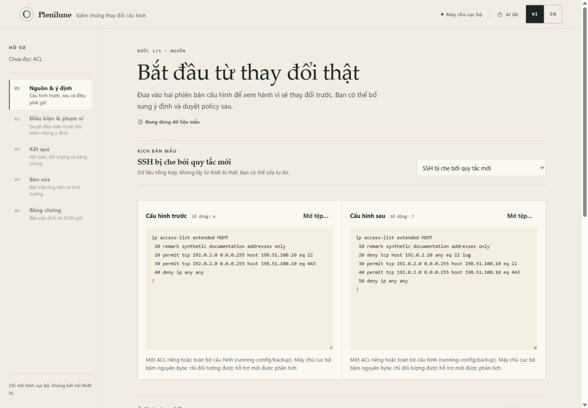

Muốn đổi ngôn ngữ giao diện: bấm **VI**/**EN** ở góc phải trên. Ứng dụng mở ở
chế độ **Kết luận nhanh**: đưa vào hai cấu hình là kết luận tự hiện; điều kiện,
bản sửa và bằng chứng đều nằm trên cùng một màn hình. Bài thực hành dưới đây
đi theo chế độ **Duyệt sâu** — quy trình 5 bước theo thứ tự: **01 Nguồn & ý
định → 02 Điều kiện & phạm vi → 03 Kết quả → 04 Bản sửa → 05 Bằng chứng**;
bấm **Duyệt sâu** ở phía trên để chuyển chế độ, và bấm số bước trên rail trái
để quay lại bước đó. Ảnh chụp màn hình trong tài liệu này là của chế độ Duyệt
sâu và sẽ được chụp lại cho chế độ Kết luận nhanh sau.

## 3. Bài thực hành 15 phút (không cần API key)

Bài này dùng đúng dữ liệu mẫu có sẵn, offline hoàn toàn. Mục tiêu: SSH từ host
quản trị `192.0.2.10` bị chặn ngoài ý muốn; bạn xác nhận, duyệt điều kiện, tạo
và kiểm chứng bản sửa, rồi tải bằng chứng.

### Bước 1 — Chọn mẫu

- **Bấm đâu:** ô **Kịch bản mẫu** (danh sách thả xuống ở khối "Kịch bản mẫu").
- **Chọn gì:** `SSH bị che bởi quy tắc mới` (đây là mẫu được chọn sẵn khi mở
  lần đầu).
- **Màn hình hiện:** hai ô **Cấu hình trước** (6 dòng) và **Cấu hình sau**
  (7 dòng) đã có sẵn nội dung; ô **Ý định thay đổi** có sẵn mô tả mong muốn.
- **Nghĩa gì:** bạn đang dùng dữ liệu tổng hợp an toàn. Địa chỉ `192.0.2.x`,
  `198.51.100.x` là địa chỉ tài liệu, không phải mạng thật.

### Bước 2 — Xem hành vi thay đổi

- **Bấm đâu:** nút **Xem hành vi thay đổi** ở cuối trang.
- **Màn hình hiện:** sang **Bước 3/5 · Kết quả**, phiếu **Kết luận** với nhãn
  `DIFFERENT` và dòng to: *"TCP 192.0.2.10 → 198.51.100.10:22: trước Cho phép,
  sau Từ chối."*
- **Nghĩa gì:**
  - `DIFFERENT` (Có thay đổi hành vi) — hai cấu hình xử lý khác nhau ở ít nhất
    một chỗ; dòng **Vì sao** ghi đúng quy tắc quyết định ở mỗi bản (kèm số dòng
    trong tệp gốc).
  - **Gói tin minh chứng: 1** — engine đưa ra một gói cụ thể chứng minh điều
    đó. Đây là một ví dụ chứng minh thay đổi, **không phải** đếm toàn bộ.
  - Dòng **Chưa duyệt điều kiện** nhắc bạn: mới so sánh hành vi, chưa xét ý định.

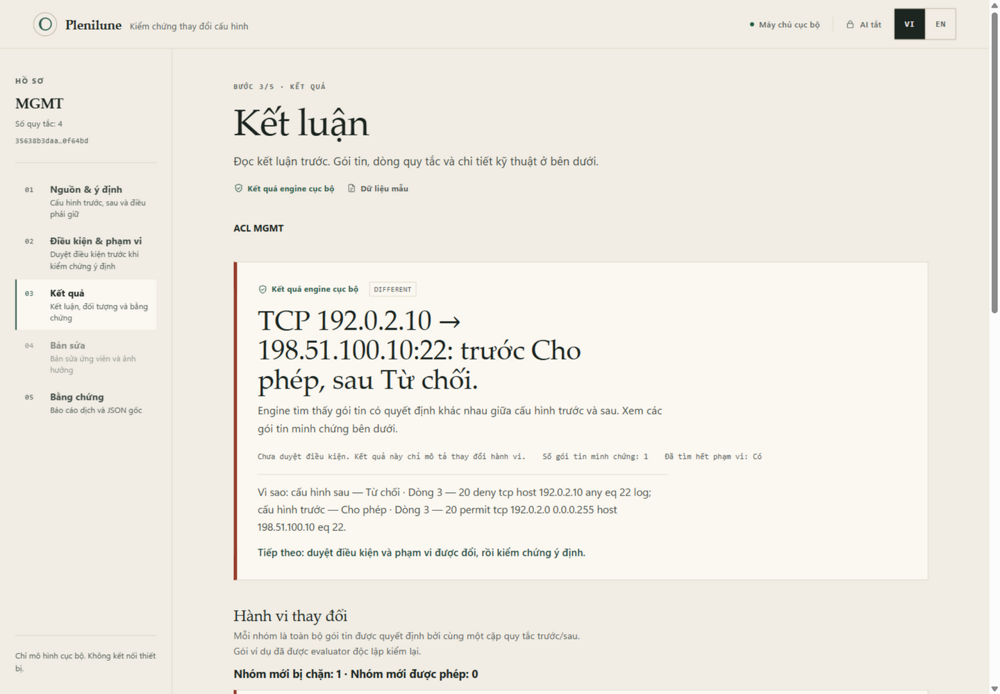

### Bước 3 — Duyệt điều kiện và phạm vi

- **Bấm đâu:** trên rail trái, bấm **02 Điều kiện & phạm vi**.
- **Màn hình hiện:** khối **Bộ điều kiện của bạn** đã có sẵn 3 điều kiện
  (OB-1, OB-2, OB-3) với tóm tắt tiếng Việt bên dưới mỗi điều kiện; khối
  **Phạm vi được phép thay đổi** đang chọn sẵn **Không cho phép thay đổi hành
  vi nào**.
- **Làm gì:**
  1. Đọc nhanh 3 điều kiện. OB-1 "Phải cho phép SSH tới jump host" là điều bị
     vi phạm; OB-2 giữ backup bị chặn; OB-3 giữ nguyên HTTPS.
  2. Giữ phạm vi **Không cho phép thay đổi hành vi nào** (chặt nhất: bản sửa
     phải hành xử giống hệt cấu hình trước).
  3. Bấm **Xem policy đã chuẩn hóa**. Mục **Các định nghĩa chính xác bạn sẽ
     duyệt** hiện ra — đây chính là nội dung engine sẽ kiểm.
  4. Tick **Tôi đã đọc và chấp nhận bộ điều kiện cùng phạm vi này**, rồi bấm
     **Chấp nhận & kiểm chứng**.
- **Nghĩa gì:** bạn vừa khai báo "đúng là những điều này tôi muốn", nên engine
  có căn cứ kết luận đạt/không đạt. Việc tick là quyết định của bạn, không phải
  chữ ký; đổi dữ liệu sau này sẽ làm mất hiệu lực bản duyệt này.

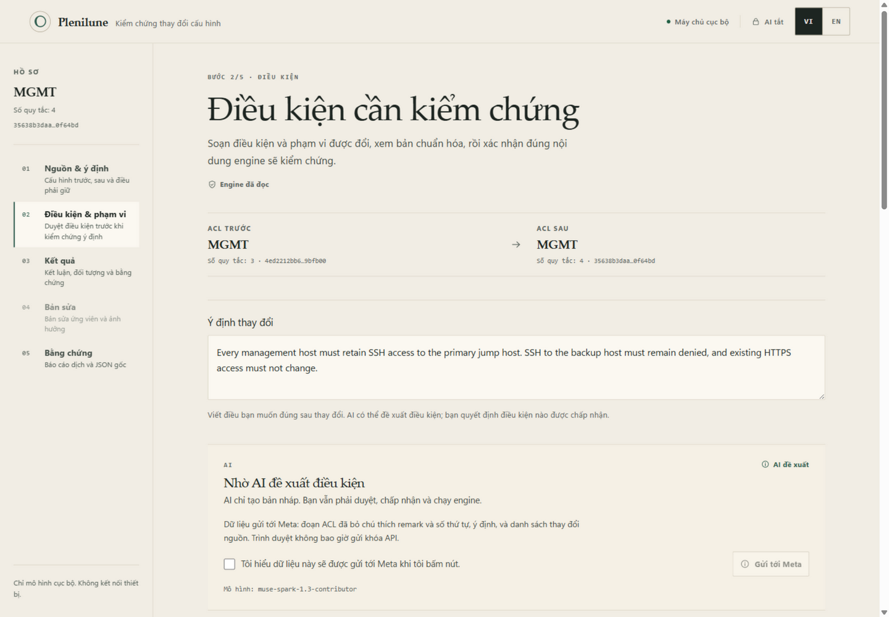

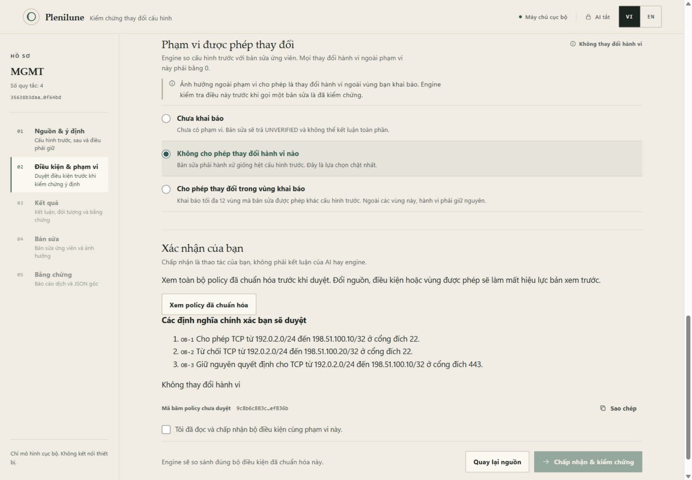

### Bước 4 — Đọc kết quả sau khi duyệt

- **Màn hình hiện:** quay lại **Kết quả** với dòng liệt kê **OB-1 không đạt ·
  OB-2 đạt · OB-3 đạt**.
  Mục **Điều kiện cần kiểm chứng** cho biết: OB-1 **Không đạt**, OB-2 **Đạt**,
  OB-3 **Đạt**. Nhóm **Mới bị chặn** giờ có thêm nhãn **Ngoài phạm vi được
  phép**.
- **Nghĩa gì:** mỗi điều kiện là một kết luận độc lập, **không phải** tỉ lệ
  hay "điểm an toàn" phần trăm.
  OB-1 không đạt vì đúng như phát hiện ban đầu: SSH tới jump host bị chặn.
  Dòng **Tiếp theo** dẫn bạn sang chuẩn bị bản sửa.

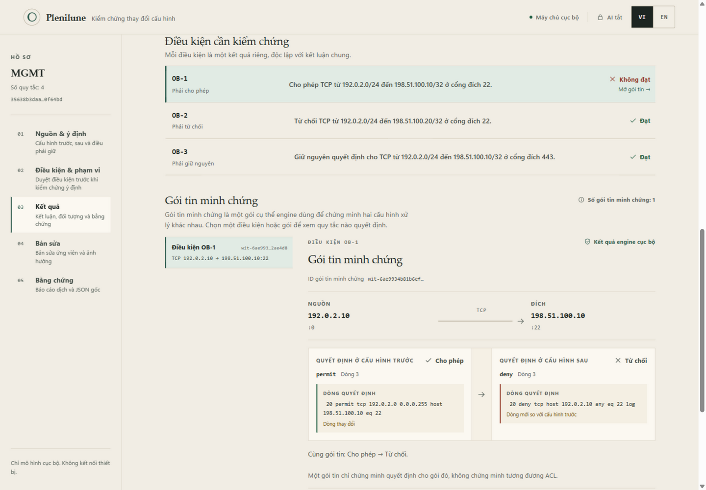

### Bước 5 — Tạo bản sửa (trong bộ nhớ)

- **Bấm đâu:** rail trái, **04 Bản sửa**.
- **Làm gì:**
  1. Tìm dòng quy tắc gây lỗi: `20 deny tcp host 192.0.2.10 any eq 22 log`
     trong khối **Tự tạo bản sửa**.
  2. Bấm **Xóa dòng** ngay trên dòng đó. Mục **Các chỉnh sửa gửi engine** ghi
     lại: *"Dòng 3: xóa quy tắc"*.
  3. Bấm **Kiểm chứng bản sửa**.
- **Màn hình hiện:** khối **Biên bản kiểm chứng** với nhãn **Đã kiểm chứng**;
  **Điều kiện trên bản sửa ứng viên**: OB-1/2/3 đều **Đạt**; **Ảnh hưởng ngoài
  phạm vi cho phép: Đã kiểm chứng — không có thay đổi hành vi**.
- **Nghĩa gì:** engine tự dựng lại cấu hình ứng viên (cấp lại số thứ tự) và
  chạy lại kiểm chứng từ đầu, trên **bộ nhớ máy bạn**. Không có thao tác áp
  dụng lên thiết bị — khung trang ghi rõ *Không chỉnh sửa nào được áp dụng lên
  thiết bị*.

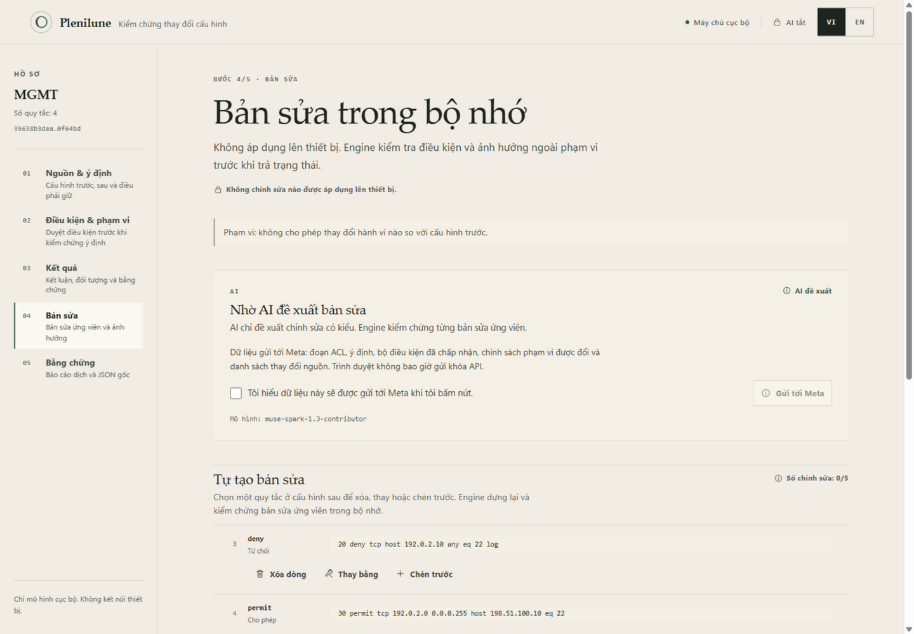

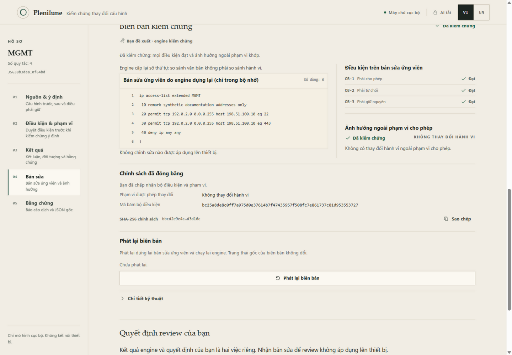

### Bước 6 — Phát lại biên bản và ghi quyết định

- **Bấm đâu:** nút **Phát lại biên bản** (cùng trang, dưới biên bản).
- **Màn hình hiện:** nhãn **Phát lại khớp**.
- **Nghĩa gì:** chạy lại engine trên đúng biên bản này ra cùng kết quả — hồ sơ
  tái lập được. Trạng thái gốc không đổi; phát lại khớp **không** xác thực ai
  đã tạo biên bản.
- Sau đó ở khối **Quyết định review của bạn**, bấm **Nhận để review**. Trạng
  thái **Đã nhận để review — chưa áp dụng** ghi nhận quyết định của phiên làm
  việc này. **Giữ lại để bổ sung** và **Từ chối bản sửa** luôn bấm được.

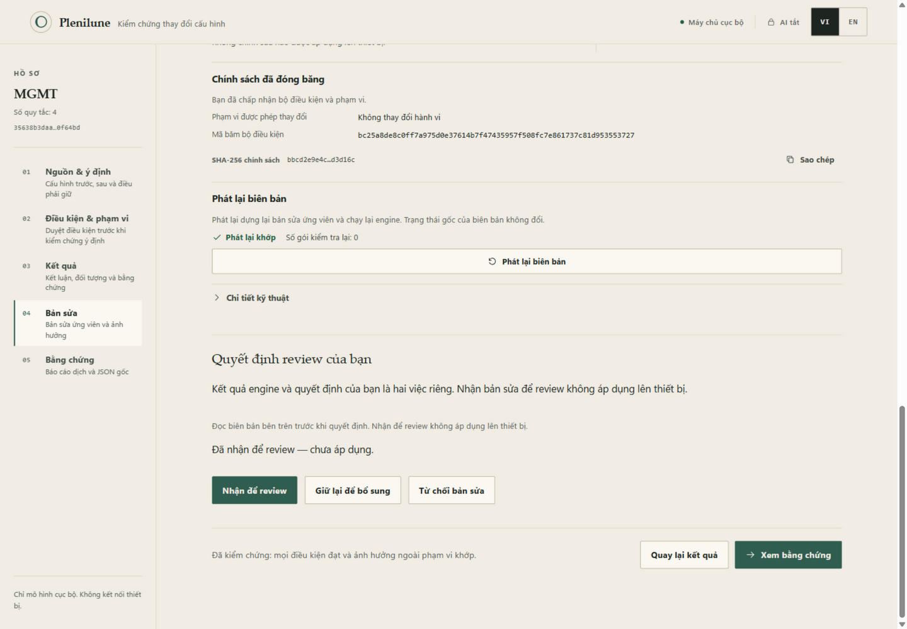

### Bước 7 — Tải báo cáo và bằng chứng

- **Bấm đâu:** nút **Xem bằng chứng** (cuối trang) hoặc rail **05 Bằng chứng**.
- **Làm gì:**
  1. Đọc **Báo cáo đã dịch** (bản tiếng Việt của toàn bộ hồ sơ). Báo cáo chỉ là
     cách đọc; JSON tải xuống mới là bằng chứng gốc.
  2. Bấm **Phát lại bằng chứng so sánh** — thấy **Phát lại khớp**.
  3. Tải tệp trong khối **Tải hồ sơ**: `before.acl`, `after.acl` (nguyên byte
     hai cấu hình), `comparison.json` (bằng chứng so sánh), `repair.json`
     (biên bản sửa), `candidate.acl` (bản ứng viên engine dựng lại),
     `analysis.json`, `replay-instructions.md` (hướng dẫn phát lại) và báo cáo
     `.md` tiếng Việt/Anh.
- **Nghĩa gì:** bộ tệp này là thứ bạn đưa cho đồng nghiệp. Họ không cần cài gì
  ngoài Plenilune để kiểm lại.

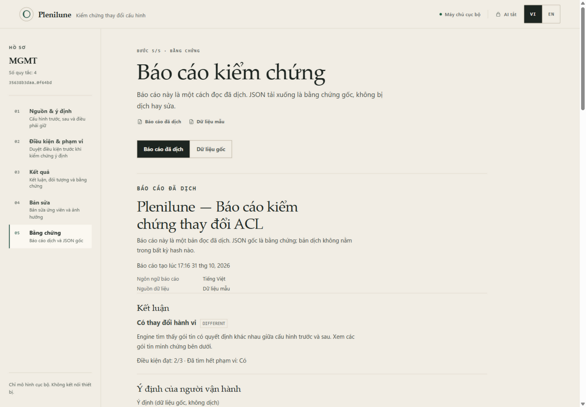

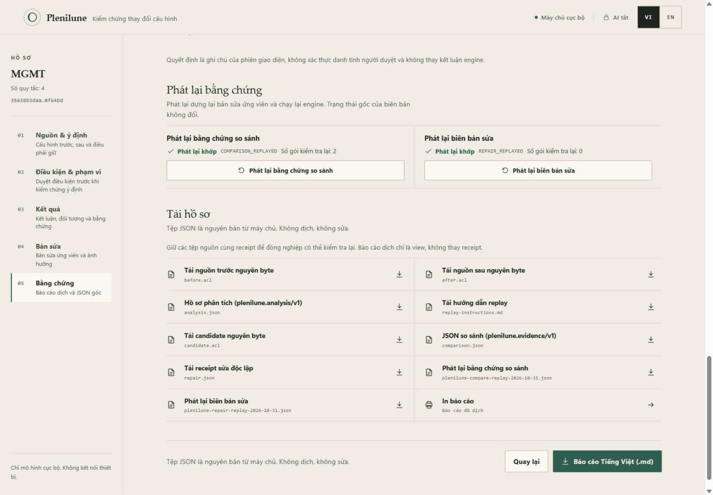

### Bước 8 — Kiểm lại trong phiên sạch (replay import)

Muốn chứng minh hồ sơ không phụ thuộc phiên của bạn: tải lại trang (AI tắt, dữ
liệu trong ô bị xóa), ở **01 Nguồn & ý định** cuộn xuống **Nhập hồ sơ để phát
lại**, chọn `before.acl` + `after.acl` + `repair.json` (hoặc `comparison.json`
nếu chỉ muốn kiểm lại kết luận so sánh), bấm **Phát lại hồ sơ**. Kết quả đúng:
**Đã tái lập kết quả gốc**. Sửa một byte trong tệp sẽ cho mismatch — đó là
chức năng, không phải lỗi.

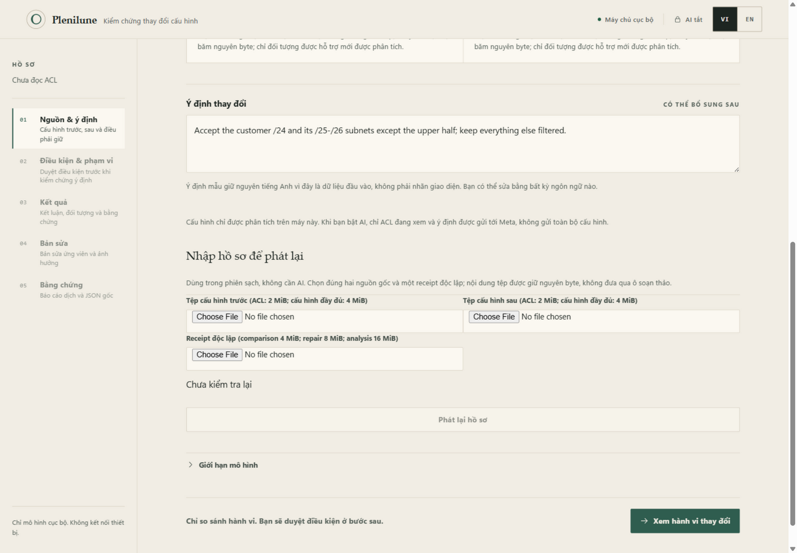

### Đi nhanh hơn: hai mẫu thứ hai đáng thử

- Chọn mẫu **Cấu hình đầy đủ: prefix-list định tuyến đổi** → **Xem hành vi thay
  đổi**. Với cấu hình đầy đủ, màn **Tổng quan thay đổi cấu hình** liệt kê từng
  đối tượng (ACL nào không đổi, prefix-list nào đổi) — bấm **Xem chi tiết** để
  vào từng đối tượng. Prefix-list hiển thị route mới được chấp nhận/bị lọc và
  nói rõ **chưa hỗ trợ điều kiện/bản sửa** cho vùng này.
- Chọn mẫu **Cú pháp ngoài phạm vi hỗ trợ** để xem app phản ứng thế nào với
  dữ liệu nó không hiểu: nó báo rõ phần nào không phân tích được thay vì đoán.

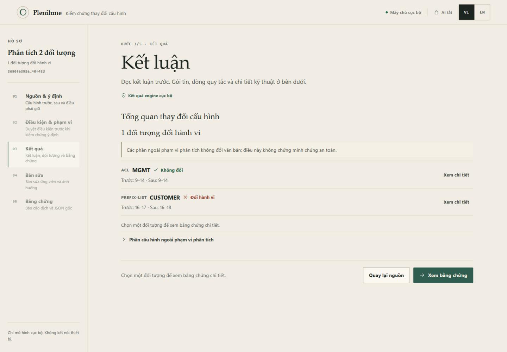

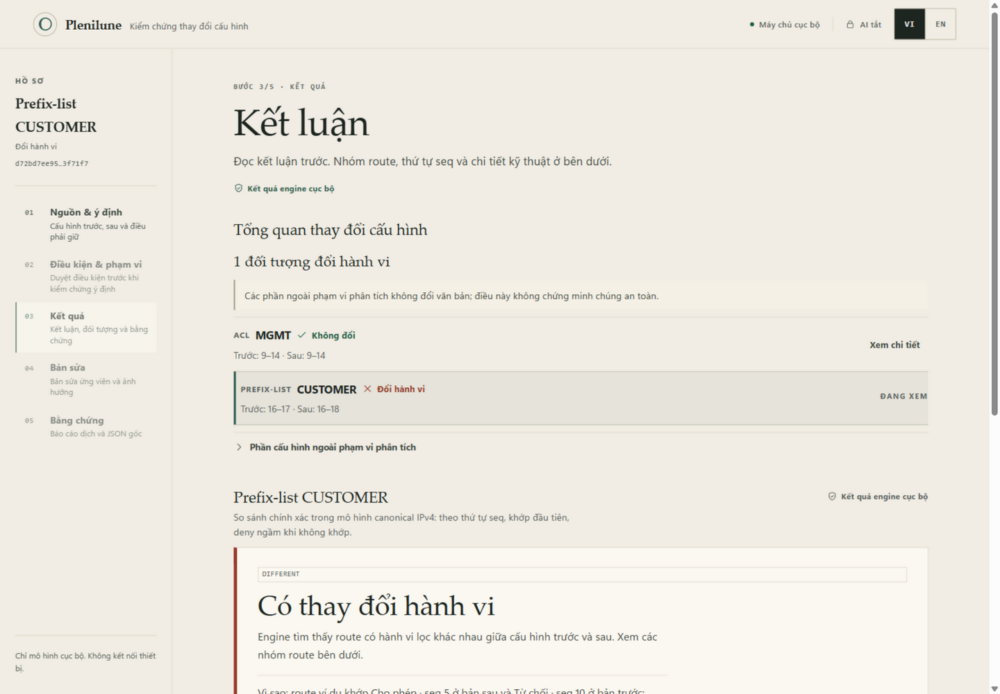

## 4. Vì sao phải duyệt điều kiện và phạm vi?

Vì engine chỉ kiểm **đúng những điều bạn phê**, và phạm vi giúp engine bắt
tác dụng phụ.

Ví dụ thực tế trên cùng mẫu: đồng nghiệp chèn dòng `deny` cho host
`192.0.2.10`. Bạn chỉ nói "SSH tới jump host phải sống" (OB-1) mà quên HTTPS.
Nếu bản sửa vô tình làm hỏng HTTPS tới `198.51.100.10`, engine vẫn báo **Đạt**
vì không ai yêu cầu giữ HTTPS — lỗi lọt qua. Đó là lý do OB-3 (giữ nguyên
HTTPS) có trong bộ điều kiện mẫu.

Phạm vi làm việc còn lại: bạn khai báo "ngoài những vùng được phép đổi, mọi
hành vi khác phải y như cấu hình trước". Chọn **Không cho phép thay đổi hành vi
nào** thì bản sửa chỉ được thay đúng chỗ điều kiện nói đến; bất kỳ thay đổi
hành vi nào khác, engine đánh dấu **Ngoài phạm vi được phép** và không gọi bản
sửa là "đã kiểm chứng".

## 5. Các từ khóa trong ứng dụng

Từ Việt trước, thuật ngữ gốc trong ngoặc.

- **Cấu hình trước / cấu hình sau** (before / after): hai phiên bản bạn đưa
  vào. "Trước" là gốc, "sau" là bản cần xem xét.
- **Điều kiện** (obligation, nhãn OB-1, OB-2…): một câu phê đúng-sai kiểu
  "phải cho phép / phải từ chối / phải giữ nguyên" cho một vùng gói tin. Ba loại
  hiện có trên giao diện đúng là: **Phải cho phép**, **Phải từ chối**,
  **Phải giữ nguyên**.
- **Phạm vi được phép thay đổi** (allowed-change scope): vùng mà bản sửa được
  phép làm hành vi khác đi so với cấu hình trước. Ngoài vùng này phải bằng 0
  thay đổi.
- **Gói tin minh chứng** (witness packet): một gói cụ thể engine dùng để chứng
  minh "chỗ này hành vi đổi". Nó chứng minh đúng gói đó, không chứng minh hai
  ACL giống nhau toàn phần.
- **Ảnh hưởng ngoài phạm vi** (collateral): thay đổi hành vi rơi ngoài vùng bạn
  cho phép. Engine phải chứng minh phần này **bằng 0** thì bản sửa mới được gọi
  là Đã kiểm chứng.
- **Policy đã chuẩn hóa** (canonical policy): bản dịch điều kiện của bạn thành
  định nghĩa chính xác (CIDR, cổng, loại trừ) mà engine sẽ kiểm — bạn duyệt
  trên bản này, không phải trên câu chữ thoáng.
- **Biên bản** (receipt): hồ sơ JSON độc lập ghi lại một kết luận (so sánh hoặc
  sửa). Tải xuống được, ai cũng phát lại được.
- **Phát lại** (replay): chạy lại engine trên đúng dữ liệu trong biên bản để
  xem có ra cùng kết quả không. Phát lại khớp xác nhận hồ sơ tái lập được;
  **không** nâng trạng thái gốc và không xác thực tác giả.
- **Kết luận engine**: `DIFFERENT` — Có thay đổi hành vi; `EQUIVALENT` — hai
  bản hành xử giống nhau trong mô hình; `INCONCLUSIVE` — chưa kết luận được
  (nguồn lực tìm kiếm cạn hoặc dữ liệu không hỗ trợ). Trạng thái chưa kết luận
  **không bao giờ** được đổi thành kết luận an toàn.
- **Thử gói này** (probe): form thử một gói tùy ý bạn nhập để xem trước/sau/
  ứng viên quyết định thế nào. Đây là cách hỏi thêm một điểm, không phải bằng
  chứng tương đương.

## 6. Dùng AI khác gì làm tay?

| | Làm tay | Có AI |
|---|---|---|
| Soạn điều kiện | Tự điền từng ô (loại, giao thức, nguồn, đích, cổng) | AI đọc ACL đang xem + ý định, đề xuất bản nháp điều kiện |
| Soạn bản sửa | Tự bấm Xóa dòng / Thay bằng / Chèn trước | AI đề xuất chỉnh sửa có kiểu |
| Kết luận | Engine quyết định | **Vẫn engine quyết định.** AI không tạo kết luận |

AI mặc định **tắt**. Toàn bộ bài thực hành ở mục 3 không cần AI.

### Bật AI cần những gì?

1. **Key chỉ vào được máy qua hộp cục bộ:** khi chạy `scripts\start-local.ps1`,
   hộp thoại **"Plenilune - Meta API setup"** hiện ra — dán key vào ô (nút
   **Paste**), rồi **Start locally**. Key chỉ nằm trong bộ nhớ process server
   của phiên này; trình duyệt không bao giờ nhận key, không được ghi vào tệp.
   Để trống là offline.
2. **Khi nào phát sinh API call?** Chỉ khi **bạn** tick
   *"Tôi hiểu dữ liệu này sẽ được gửi tới Meta khi tôi bấm nút."* và bấm
   **Gửi tới Meta** — có ở **02 Điều kiện & phạm vi** (đề xuất điều kiện) và
   **04 Bản sửa** (đề xuất bản sửa). Mở app, so sánh, kiểm chứng, phát lại…
   không gọi AI. Dữ liệu gửi đi là đoạn ACL đang xem (đã bỏ chú thích remark và
   số thứ tự), ý định, và ở bước bản sửa thêm bộ điều kiện đã chấp nhận, chính
   sách phạm vi và danh sách thay đổi nguồn — không phải toàn bộ running-config.
3. Model cố định `muse-spark-1.3-contributor`, không có fallback. Đề xuất AI
   hiện ra là **bản nháp**: bạn vẫn phải duyệt policy, tick chấp nhận và chạy
   engine như mục 3.

> **Ghi rõ phạm vi kiểm chứng:** mục này viết theo thiết kế và mã nguồn. Trong
> phiên viết tài liệu (31/10/2026) **chưa bấm Gửi tới Meta thật** và chưa chạy
> luồng AI live, nên thông báo khi key sai/thiếu chỉ ghi theo mã: nếu server
> chưa có key, ứng dụng hiển thị "Máy chủ chưa có khóa Meta. Meta không được
> gọi; bạn vẫn có thể tự soạn điều kiện." và badge chuyển thành **AI chưa cấu
> hình**. Luồng live với Meta cần chạy kiểm riêng trước khi tin nhãn này.

## 7. Xử lý sự cố thường gặp

- **Trang không mở / "không thể truy cập trang này":** cửa sổ PowerShell chạy
  server có thể đã bị đóng. Mở lại theo mục 2 rồi refresh trang Brave. Địa chỉ
  đúng là `http://127.0.0.1:8082` (không phải https).
- **Cửa sổ PowerShell báo server đã chiếm cổng:** đã có một bản Plenilune đang
  chạy. Đừng chạy hai bản; dùng lại trang Brave đang mở, hoặc đóng bản cũ rồi
  chạy lại.
- **Badge ghi "AI chưa cấu hình" hoặc nút "Gửi tới Meta" bật mà báo lỗi:**
  server đang chạy mà không có key. Không thể bật AI cho phiên này từ trình
  duyệt — phải chạy lại `start-local.ps1` và nhập key ở hộp cục bộ. Làm tay
  vẫn dùng được toàn bộ.
- **Input không hỗ trợ:** cấu hình có cú pháp ngoài ACL/prefix-list thì app
  liệt kê vào **Phần cấu hình ngoài phạm vi phân tích** và **không** đưa ra kết
  luận cho phần đó. Đây là hành vi đúng, không phải lỗi.
- **Kết quả chưa kết luận được** (`INCONCLUSIVE`, hoặc thông báo ngân sách tìm
  kiếm cạn): không coi đó là "an toàn" hay "không đổi". Thu hẹp dữ liệu hoặc
  xem lại phần không hỗ trợ, rồi chạy lại.
- **Sửa dữ liệu làm mất kết quả cũ:** đổi ô cấu hình, điều kiện hay phạm vi là
  app reset ngay về "Chưa đọc…" (đã thử thật: rail về trạng thái ban đầu, các
  bước 02–05 khóa lại). Kết quả cũ chỉ còn trong các tệp bạn đã tải về — tải
  hồ sơ trước khi muốn chỉnh tiếp.
- **Biên bản phát lại không khớp sau khi đổi tệp:** đúng như thiết kế. Lấy lại
  bộ tệp đúng lần xuất đó (hoặc xuất mới); không sửa receipt cho khớp.

## 8. Tờ làm nhanh

1. PowerShell trong thư mục dự án → chạy
   `scripts\start-local.ps1` → để trống key → **Start locally**.
2. Brave mở `http://127.0.0.1:8082` — phải thấy **Máy chủ cục bộ**, **AI tắt**.
   Giữ cửa sổ PowerShell mở.
3. Chọn **Kịch bản mẫu** → bấm **Xem hành vi thay đổi** → đọc phiếu Kết luận
   (DIFFERENT, gói minh chứng, Vì sao).
4. Rail **02 Điều kiện & phạm vi** → đọc OB-1…, giữ **Không cho phép thay đổi
   hành vi nào** → **Xem policy đã chuẩn hóa** → tick → **Chấp nhận & kiểm
   chứng**.
5. Đọc kết quả (dòng liệt kê trạng thái từng điều kiện OB-1…, nhãn Ngoài phạm
   vi được phép).
6. Rail **04 Bản sửa** → bấm **Xóa dòng** trên quy tắc gây lỗi → **Kiểm chứng
   bản sửa** → thấy **Đã kiểm chứng**.
7. **Phát lại biên bản** → **Phát lại khớp** → **Nhận để review** (chưa áp dụng
   lên thiết bị).
8. **Xem bằng chứng** → đọc **Báo cáo đã dịch** → **Phát lại bằng chứng so
   sánh** → tải tệp ở **Tải hồ sơ**.
9. Phiên sạch: **Nhập hồ sơ để phát lại** với 2 tệp nguồn + 1 receipt →
   **Phát lại hồ sơ** → phải khớp.
10. Gặp lỗi: mục 7 của tài liệu này.

## Ghi chú về ảnh

Ảnh chụp ngày 31/10/2026 từ giao diện local (bảng màu sáng) chạy đúng bộ dữ liệu
mẫu của ứng dụng — toàn bộ là dữ liệu tổng hợp, không có key hay thông tin cá
nhân. Ảnh phản ánh đúng nhãn và thứ tự nút tại thời điểm chụp.
