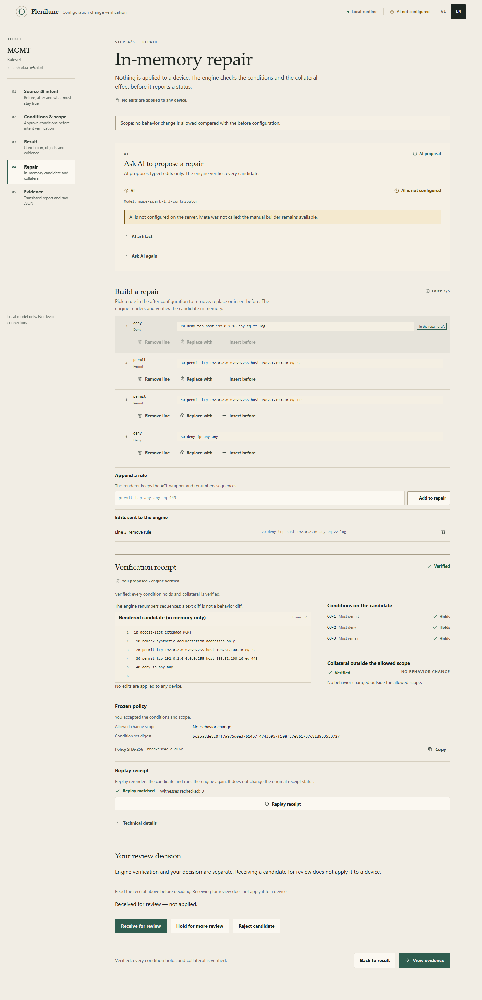
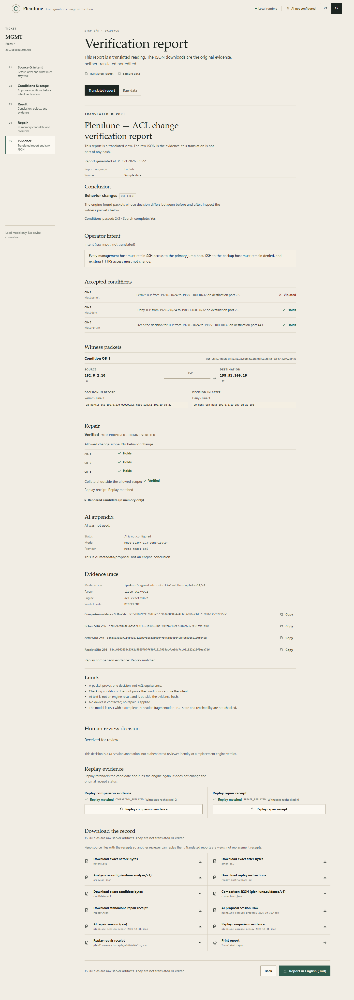
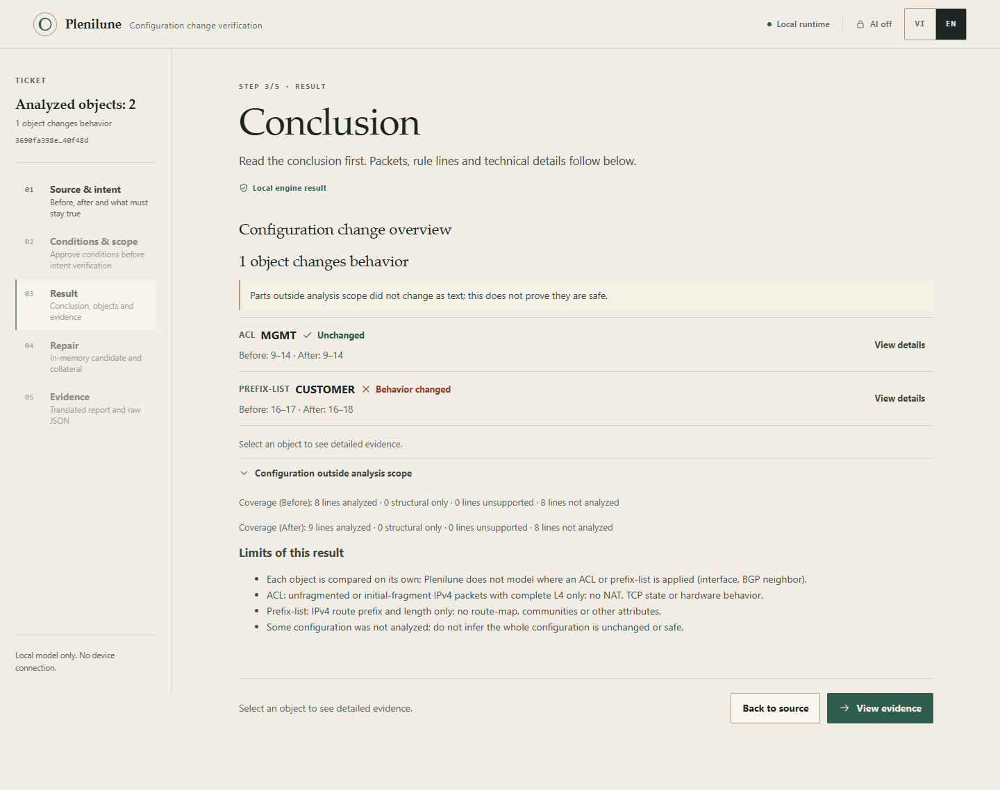
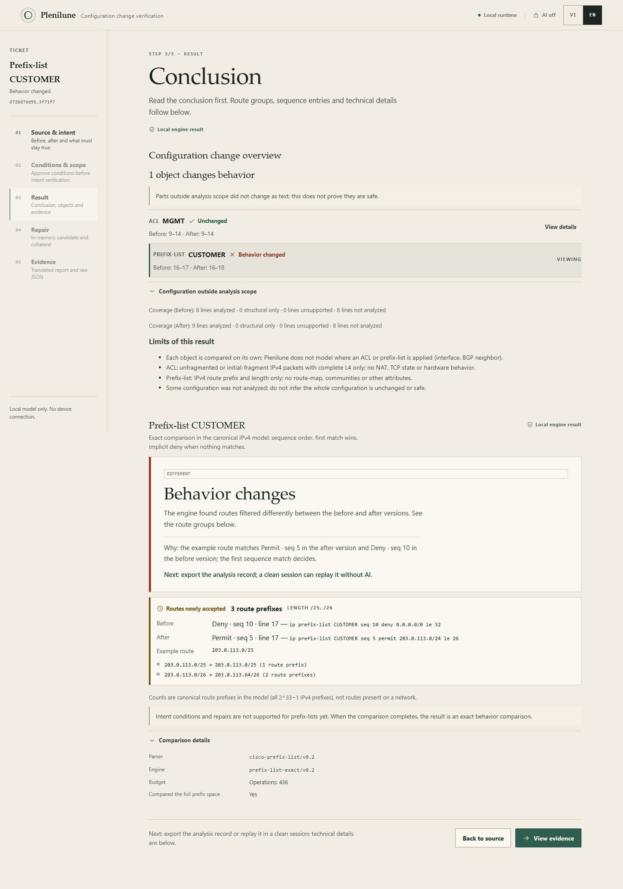

# Two Plenilune walkthroughs (EN)

> All data in both walkthroughs is **synthetic**: documentation addresses
> (`192.0.2.0/24`, `198.51.100.0/24`, `203.0.113.0/24`), not taken from a
> device, customer or live network. Both scenarios use the samples in
> [`web/src/lib/samples.ts`](../web/src/lib/samples.ts); the **Sample data**
> label is shown next to the source.
>
> These walkthroughs run fully offline and need no key. AI is off by default and
> is not called. Plenilune does not contact a device and does not apply a
> repair. Screenshots are from the UI QA run on 31 October 2026; see the
> [QA handoff](handoff/demo-ui-public.md) for the verified scope.

Vietnamese version: [walkthrough-vi.md](walkthrough-vi.md).

## Setup (offline, no key)

```sh
go build -o bin/plenilune.exe ./cmd/plenilune
go build -o bin/plenilune-demo.exe ./cmd/plenilune-demo
cd web
npm ci
npm test
npm run build
cd ..
```

Start the local server:

```sh
./bin/plenilune-demo.exe -addr 127.0.0.1:8082 -web web/dist
```

Open `http://127.0.0.1:8082`. You can also run `./scripts/start-local.ps1` and
leave the key box empty for offline mode; the script keeps a key only in its own
process if you enter one. The initial state should read **Local runtime**, **AI
off**, **Sample data**.

## Walkthrough 1 — Unintended ACL drift

### Scenario

A seemingly small change adds a `deny` rule for one management host. The new
rule sits before the old permit, so SSH from that host is now denied.

```text
# Before (synthetic)
ip access-list extended MGMT
 10 remark synthetic documentation addresses only
 20 permit tcp 192.0.2.0 0.0.0.255 host 198.51.100.10 eq 22
 30 permit tcp 192.0.2.0 0.0.0.255 host 198.51.100.10 eq 443
 40 deny ip any any
!

# After (synthetic)
ip access-list extended MGMT
 10 remark synthetic documentation addresses only
 20 deny tcp host 192.0.2.10 any eq 22 log
 30 permit tcp 192.0.2.0 0.0.0.255 host 198.51.100.10 eq 22
 40 permit tcp 192.0.2.0 0.0.0.255 host 198.51.100.10 eq 443
 50 deny ip any any
!
```

### 1. Source

1. On **Source & intent**, choose the sample **SSH hidden by a new rule** (it is
   selected when the app first opens).
2. Keep both configuration panes and the intent. The sample intent remains in
   English because it is input data, not a UI label.
3. Select **View behavior changes**.

Plenilune reads the configurations, inventories objects and compares behavior.
No AI request is made.

### 2. Delta result (no accepted conditions yet)


- Local engine verdict: `DIFFERENT` — **Behavior changes**.
- The headline names the packet: `TCP 192.0.2.10 → 198.51.100.10:22`, before
  **Permit**, after **Deny**.
- The **Why** line names the deciding rule in both versions: `20 deny ...` on
  line 3 of the after configuration and `20 permit ...` on line 3 of the before
  configuration. This is witness evidence, not an inference from the text diff.
- **Behavior that changed** contains one newly denied group; the example packet
  was re-checked by an independent evaluator.
- **Next** is stated on the plate: review conditions and allowed scope. No
  conditions have been accepted, so there is no intent conclusion and no repair
  acceptance control yet.

### 3. Conditions and scope

1. Select **Conditions & scope** in the rail, or the button **Define conditions
   and allowed scope**.
2. Check the three existing conditions:
   - **OB-1** `must_permit`: TCP `192.0.2.0/24` → `198.51.100.10/32`, destination
     port 22.
   - **OB-2** `must_deny`: TCP `192.0.2.0/24` → `198.51.100.20/32`, destination
     port 22.
   - **OB-3** `must_remain`: TCP `192.0.2.0/24` → `198.51.100.10/32`, destination
     port 443.
3. Keep the scope **Allow no behavior change**. This is the strictest choice: a
   repair must preserve the before configuration's behavior across the whole
   model.
4. Select **Preview normalized policy** and read **The exact definitions you
   will accept**. Check CIDRs, ports, exclusions and scope before agreeing.
5. Tick **I have read and accept these conditions and this scope**, then select
   **Accept & verify**.

This step is your decision. The engine runs only on the exact normalized
policy; ticking is not a signature or identity proof.

### 4. Result after acceptance

- The verdict remains `DIFFERENT`; conditions passed: **2/3**.
- **OB-1 violated** because SSH from a host inside the management subnet is now
  denied; **OB-2 holds** (the backup host remains denied); **OB-3 holds** (HTTPS
  is unchanged).
- 2/3 is **not** a 67% safety score. These are three independent outcomes, not a
  percentage.
- **Next** changes to preparing a repair.

### 5. In-memory repair



1. Select **Prepare a repair**.
2. Under **Build a repair yourself**, choose the after rule `20 deny tcp host
   192.0.2.10 any eq 22 log` and select **Remove line**. The draft shows
   `Line 3: remove rule`.
3. Select **Verify repair**. The engine rebuilds the candidate in memory and
   re-checks it from the start.
4. Read the receipt before deciding:
   - Status **Verified** (`VERIFIED`).
   - OB-1, OB-2 and OB-3 all **hold**.
   - **Collateral outside allowed scope: Verified** — no behavior change outside
     that scope.
   - The candidate keeps the rest of the after configuration; the engine
     reassigns sequence numbers, so text comparison is not behavior comparison.
5. Select **Replay receipt** to rebuild the candidate and rerun the engine.
   **Replay matched** (`REPAIR_REPLAYED`) means this receipt is reproducible; it
   does not upgrade the original status or authenticate the author.

### 6. Review decision

- **Your review decision** appears **after** the receipt, so the evidence is
  read first.
- Select **Receive for review**. The UI records **Received for review — not
  applied**.
- Receiving for review is a UI-session decision tied to the receipt hash; it is
  not a signed approval and does not replace the engine verdict. It applies
  nothing to a device.
- If replay does not match or the receipt is `TIMING_SENSITIVE`, receiving is
  blocked (and a previous received decision is cleared) until replay matches or
  a new verification completes. **Hold** and **Reject** remain available.

### 7. Evidence and replay



1. Select **View evidence**.
2. Read the **Translated report** (VI/EN). The report is a view; the raw JSON is
   the artifact.
3. Open **Raw data** to inspect `plenilune.evidence/v1` and
   `plenilune.repair/v1`.
4. Download what you need:
   - `before.acl`, `after.acl` — the exact bytes sent to the engine;
   - `comparison.json`, `repair.json` — standalone receipts;
   - `candidate.acl` — the candidate rebuilt by the engine;
   - `replay-instructions.md` — replay commands;
   - the VI/EN report.
5. Use **Replay comparison evidence** and **Replay repair receipt** to check it
   in the current session.

Replay in a **clean session** with AI off:

1. Reload the page or open a new window.
2. On **Source & intent**, open **Import files for replay**.
3. Choose `before.acl`, `after.acl` and `repair.json`.
4. Select **Replay imported files**.

The expected result is **Reproduced the original outcome**, code
`REPAIR_REPLAYED`. Changing one byte in a configuration or receipt produces a
mismatch; do not edit the receipt to make it match. To re-check the comparison,
use `comparison.json` the same way.

Equivalent CLI:

```sh
plenilune replay --before before.acl --after after.acl --evidence comparison.json
plenilune repair-replay --before before.acl --after after.acl --evidence repair.json
```

### What not to infer

- A witness proves a decision for **one packet**; it does not prove two ACLs are
  equivalent.
- 2/3 conditions holding is not a safety score.
- `VERIFIED` means the accepted policy and collateral outside the allowed scope
  were checked; it does not mean a device, NAT, TCP state or every possible
  intent was checked.
- Hashes check content, not the author or the person who approved.
- The repair lives in memory only; nothing is applied.

## Walkthrough 2 — Prefix-list route-region change

### Scenario

A routing prefix-list is changed to accept sub-prefixes but reject the upper
half of the `/24`. This is a route comparison in the canonical IPv4 model, not
a BGP check on a device.

```text
# Before (synthetic)
ip prefix-list CUSTOMER seq 5 permit 203.0.113.0/24
ip prefix-list CUSTOMER seq 10 deny 0.0.0.0/0 le 32

# After (synthetic)
ip prefix-list CUSTOMER seq 3 deny 203.0.113.128/25 le 32
ip prefix-list CUSTOMER seq 5 permit 203.0.113.0/24 le 26
ip prefix-list CUSTOMER seq 10 deny 0.0.0.0/0 le 32
```

### 1. Source and overview

1. Choose the sample **Full configuration: routing prefix-list changes**.
2. Select **View behavior changes**.
3. Read **Configuration change overview**:
   - **1 object changes behavior**;
   - **ACL MGMT — Unchanged**;
   - **PREFIX-LIST CUSTOMER — Behavior changed**;
   - the unanalyzed configuration is named explicitly: unchanged text **does
     not** prove it is safe.
4. Select **View details** next to `PREFIX-LIST CUSTOMER`.

Opening the prefix object does not run ACL parse/compare; it is a separate
analysis path.



### 2. Prefix-list result



- Verdict `DIFFERENT` — **Behavior changes**.
- **Why**: the example route `203.0.113.0/25` matches `permit · seq 5` in the
  after version and `deny · seq 10` in the before version; the first sequence
  match decides.
- **Routes newly accepted: 3 route prefixes**, lengths `/25` and `/26`.
- Exact ranges: `203.0.113.0/25` and `203.0.113.0/26 → 203.0.113.64/26`.
- **Limits next to the counts**: these are canonical route prefixes in the model
  (all `2^33−1` IPv4 prefixes), not routes present on a network.
- Prefix-lists **do not support intent conditions or repairs** yet; the screen
  says so instead of pretending to evaluate ACL packets/rules.
- **Next**: export the analysis record.

### 3. Evidence and fresh replay

1. Select **View evidence**.
2. Download `before.cfg`, `after.cfg`, `analysis.json` and
   `replay-instructions.md`.
3. Select **Replay analysis record**; the expected result is
   `ANALYSIS_REPLAYED`.
4. In a **clean session** (reload, AI off), open **Import files for replay**,
   choose the three files and select **Replay imported files**. The result must
   match `objects=2 changed=1` (per the receipt).
5. Change one byte in `after.cfg` and try again: it must mismatch. If the
   receipt is `TIMING_SENSITIVE`, the UI shows **full replay not confirmed**,
   never matched.

CLI:

```sh
plenilune analyze --before before.cfg --after after.cfg
plenilune analyze-replay --before before.cfg --after after.cfg --evidence analysis.json
```

### What not to infer

- Route counts are **canonical prefixes in the model**, not live routes.
- Route-maps, communities, BGP attributes and where the prefix-list is attached
  (BGP neighbor) are not modeled.
- There is no device, firmware or real connectivity conclusion.
- `ANALYSIS_REPLAYED` confirms content/version consistency; it does not
  authenticate the author.

## Independent replay — common rules

- Keep the exact bytes of configurations and receipts, including CRLF, BOM and
  the final newline.
- Use the receipt kind and the parser/engine versions recorded in the receipt.
- `TIMING_SENSITIVE` is not a full replay match.
- A matched replay does not upgrade the original verdict (for example,
  `REJECTED` remains `REJECTED`).
- Hashes check content; they do not prove authorship, approval or environment
  immutability.
- Do not edit a receipt or configuration to make it match; get the original
  source/build.

## QA note

- 31 October 2026; Brave 156.0.8078.80; viewports 1440, 390 and 320; VI/EN;
  light and dark; axe reports no serious/critical violations.
- Separate QA server without a key; no Meta call; no external request.
- Check count and screenshots: local
  `out/qa-ui-2026-10-31/browser/browser-results.json` (not public) and the
  [handoff](handoff/demo-ui-public.md).
- Live UI with Meta **was not run** in this pass; do not infer it from offline
  QA.
