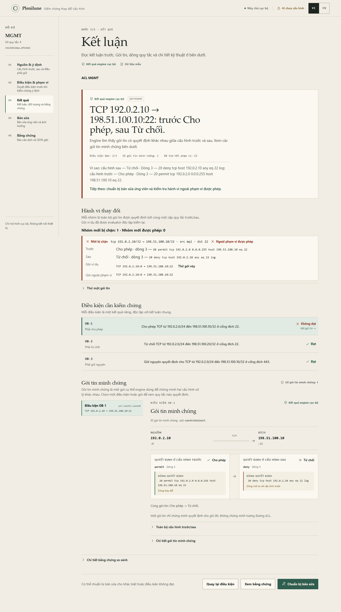
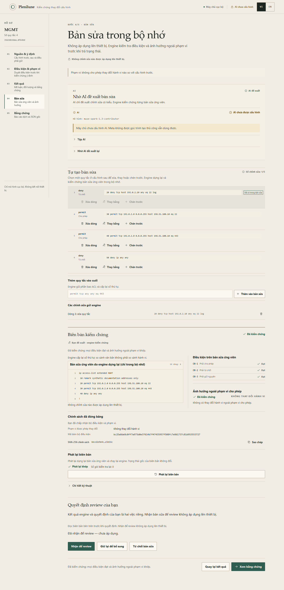
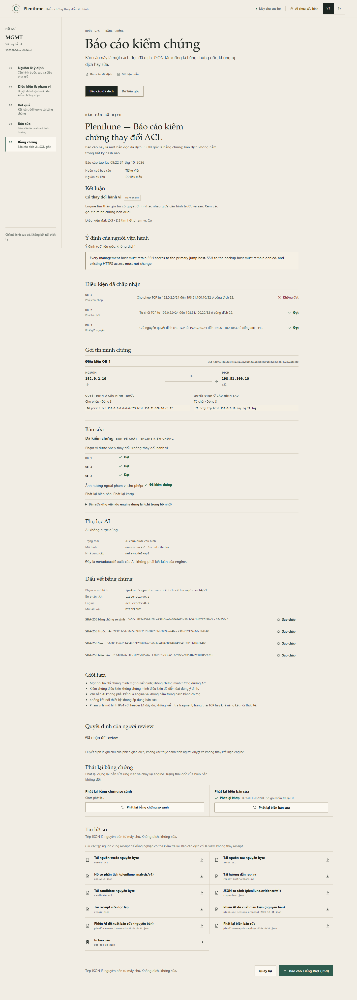
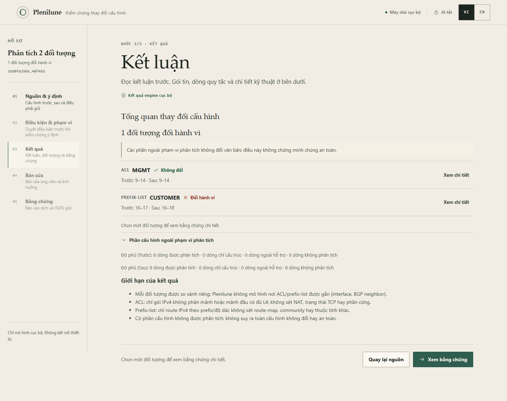
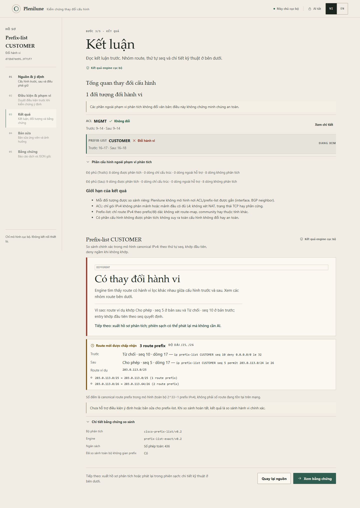

# Hai walkthrough Plenilune (VI)

> Mới dùng Plenilune? Bắt đầu từ [hướng dẫn sử dụng từng bước](usage-vi.md);
> trang này đi sâu hai kịch bản kèm lệnh replay độc lập.
>
> Toàn bộ dữ liệu trong hai walkthrough là **synthetic**: địa chỉ tài liệu
> (`192.0.2.0/24`, `198.51.100.0/24`, `203.0.113.0/24`), không lấy từ thiết bị,
> khách hàng hay mạng thật. Hai kịch bản dùng các mẫu trong
> [`web/src/lib/samples.ts`](../web/src/lib/samples.ts); nhãn **Dữ liệu mẫu**
> xuất hiện cạnh nguồn.
>
> Walkthrough này chạy hoàn toàn offline, không cần key. AI tắt mặc định và
> không được gọi. Plenilune không kết nối thiết bị và không áp dụng bản sửa.
> Ảnh chụp lấy từ lần QA UI ngày 31/10/2026; xem [báo cáo QA](../docs/handoff/demo-ui-public.md)
> để biết phạm vi đã kiểm chứng.

Bản tiếng Anh: [walkthrough-en.md](walkthrough-en.md).

## Chuẩn bị (offline, không key)

```sh
go build -o bin/plenilune.exe ./cmd/plenilune
go build -o bin/plenilune-demo.exe ./cmd/plenilune-demo
cd web
npm ci
npm test
npm run build
cd ..
```

Chạy server cục bộ:

```sh
./bin/plenilune-demo.exe -addr 127.0.0.1:8082 -web web/dist
```

Mở `http://127.0.0.1:8082`. Có thể dùng `./scripts/start-local.ps1` và để trống
ô key để chạy offline; script chỉ giữ key trong process nếu bạn nhập. Trạng thái
đúng ban đầu: **Máy chủ cục bộ**, **AI tắt**, **Dữ liệu mẫu**.

## Walkthrough 1 — ACL đổi ngoài ý muốn

### Bối cảnh

Một thay đổi tưởng như nhỏ thêm quy tắc `deny` cho một host quản trị. Quy tắc
mới đứng trước permit cũ, nên SSH từ host đó bị chặn.

```text
# Trước (synthetic)
ip access-list extended MGMT
 10 remark synthetic documentation addresses only
 20 permit tcp 192.0.2.0 0.0.0.255 host 198.51.100.10 eq 22
 30 permit tcp 192.0.2.0 0.0.0.255 host 198.51.100.10 eq 443
 40 deny ip any any
!

# Sau (synthetic)
ip access-list extended MGMT
 10 remark synthetic documentation addresses only
 20 deny tcp host 192.0.2.10 any eq 22 log
 30 permit tcp 192.0.2.0 0.0.0.255 host 198.51.100.10 eq 22
 40 permit tcp 192.0.2.0 0.0.0.255 host 198.51.100.10 eq 443
 50 deny ip any any
!
```

### 1. Nguồn

1. Ở bước **Nguồn & ý định**, chọn mẫu **SSH bị che bởi quy tắc mới** (mẫu
   này được chọn sẵn khi mở lần đầu).
2. Giữ nguyên hai ô cấu hình và ý định. Ý định mẫu giữ nguyên tiếng Anh vì đây
   là dữ liệu đầu vào, không phải nhãn giao diện.
3. Bấm **Xem hành vi thay đổi**.

Plenilune đọc cấu hình, lập inventory đối tượng và so sánh hành vi. Không có
yêu cầu AI nào được gửi.

### 2. Kết quả delta (chưa duyệt điều kiện)



- Kết luận engine cục bộ: `DIFFERENT` — **Có thay đổi hành vi**.
- Headline nêu đúng gói: `TCP 192.0.2.10 → 198.51.100.10:22`, trước **Cho
  phép**, sau **Từ chối**.
- Dòng **Vì sao** nêu quy tắc quyết định ở cả hai bản: `20 deny ...` ở dòng 3
  của bản sau và `20 permit ...` ở dòng 3 của bản trước. Đây là bằng chứng của
  witness, không phải suy luận từ diff văn bản.
- **Hành vi thay đổi** có 1 nhóm mới bị chặn; gói ví dụ đã được evaluator độc
  lập kiểm lại.
- **Bước tiếp theo** được nêu ngay trên phiếu: duyệt điều kiện và phạm vi.
  Chưa có điều kiện nào được duyệt, nên chưa có kết luận về ý định và chưa có
  nút nhận bản sửa.

### 3. Điều kiện & phạm vi

1. Bấm **Điều kiện & phạm vi** ở rail hoặc nút **Xác định điều kiện và phạm vi
   được đổi**.
2. Kiểm tra ba điều kiện đã có:
   - **OB-1** `must_permit`: TCP `192.0.2.0/24` → `198.51.100.10/32`, cổng đích
     22.
   - **OB-2** `must_deny`: TCP `192.0.2.0/24` → `198.51.100.20/32`, cổng đích
     22.
   - **OB-3** `must_remain`: TCP `192.0.2.0/24` → `198.51.100.10/32`, cổng đích
     443.
3. Giữ phạm vi **Không cho phép thay đổi hành vi nào**. Đây là lựa chọn chặt
   nhất: bản sửa phải giữ hành vi của cấu hình trước trên toàn mô hình.
4. Bấm **Xem policy đã chuẩn hóa**, đọc phần **Các định nghĩa chính xác bạn sẽ
   duyệt**. Kiểm tra CIDR, cổng, ngoại lệ và phạm vi trước khi đồng ý.
5. Tick **Tôi đã đọc và chấp nhận bộ điều kiện cùng phạm vi này**, rồi bấm
   **Chấp nhận & kiểm chứng**.

Bước này là quyết định của bạn. Engine chỉ chạy trên đúng policy đã chuẩn hóa;
việc tick không phải chữ ký hay xác thực danh tính.

### 4. Kết quả sau khi duyệt

- Kết luận vẫn `DIFFERENT`; điều kiện đạt **2/3**.
- **OB-1 Không đạt** vì SSH từ một host trong subnet quản trị đã bị chặn;
  **OB-2 Đạt** (backup vẫn bị chặn); **OB-3 Đạt** (HTTPS không đổi).
- 2/3 **không phải** điểm an toàn 67%. Đây là ba kết quả độc lập, không phải
  phần trăm.
- Dòng **Bước tiếp theo** chuyển sang chuẩn bị bản sửa.

### 5. Bản sửa trong bộ nhớ



1. Bấm **Chuẩn bị bản sửa**.
2. Trong **Tự tạo bản sửa**, chọn dòng `20 deny tcp host 192.0.2.10 any eq 22
   log` ở **Quy tắc ở cấu hình sau** và bấm **Xóa dòng**. Bản nháp ghi
   `Dòng 3: xóa quy tắc`.
3. Bấm **Kiểm chứng bản sửa**. Engine dựng lại candidate trong bộ nhớ và kiểm
   tra lại từ đầu.
4. Đọc biên bản trước khi quyết định:
   - Trạng thái **Đã kiểm chứng** (`VERIFIED`).
   - Cả OB-1, OB-2, OB-3 **Đạt**.
   - **Ảnh hưởng ngoài phạm vi cho phép: Đã kiểm chứng** — không có thay đổi
     hành vi ngoài phạm vi.
   - Candidate giữ đúng phần còn lại của cấu hình sau; engine cấp lại số thứ
     tự, nên so sánh văn bản không phải so sánh hành vi.
5. Bấm **Phát lại biên bản** để dựng lại candidate và chạy lại engine. Trạng
   thái **Phát lại khớp** (`REPAIR_REPLAYED`) chỉ có nghĩa là receipt này tái
   lập được; nó không nâng trạng thái gốc và không xác thực tác giả.

### 6. Quyết định review

- Khối **Quyết định review của bạn** nằm **sau** biên bản, để bạn đọc bằng
  chứng trước.
- Chọn **Nhận để review**. UI ghi **Đã nhận để review — chưa áp dụng**.
- **Nhận để review** là quyết định của phiên giao diện, gắn với hash receipt;
  đây không phải bằng chứng đã ký và không thay thế kết luận engine. Nó cũng
  không áp dụng gì lên thiết bị.
- Nếu replay không khớp hoặc receipt `TIMING_SENSITIVE`, việc nhận bị chặn (và
  quyết định nhận cũ bị bỏ) cho tới khi replay khớp hoặc có kiểm chứng mới.
  **Giữ lại** và **Từ chối** luôn dùng được.

### 7. Bằng chứng và replay



1. Bấm **Xem bằng chứng**.
2. Đọc **Báo cáo đã dịch** (VI/EN). Báo cáo chỉ là view; JSON gốc là artifact.
3. Mở **Dữ liệu gốc** để xem `plenilune.evidence/v1` và
   `plenilune.repair/v1`.
4. Tải các tệp cần thiết:
   - `before.acl`, `after.acl` — đúng byte đã gửi engine;
   - `comparison.json`, `repair.json` — receipt độc lập;
   - `candidate.acl` — candidate engine dựng lại;
   - `replay-instructions.md` — lệnh replay;
   - báo cáo VI/EN.
5. Bấm **Phát lại bằng chứng so sánh** và **Phát lại biên bản sửa** để kiểm
   tra ngay trong phiên hiện tại.

Replay trong **phiên sạch**, AI tắt:

1. Tải lại trang hoặc mở cửa sổ mới.
2. Ở **Nguồn & ý định**, mở **Nhập hồ sơ để phát lại**.
3. Chọn `before.acl`, `after.acl` và `repair.json`.
4. Bấm **Phát lại hồ sơ**.

Kết quả đúng: **Đã tái lập kết quả gốc**, mã `REPAIR_REPLAYED`. Đổi một byte
trong cấu hình hoặc receipt sẽ cho mismatch; không sửa receipt cho khớp. Muốn
kiểm lại kết luận so sánh, dùng `comparison.json` theo cùng cách.

CLI tương đương:

```sh
plenilune replay --before before.acl --after after.acl --evidence comparison.json
plenilune repair-replay --before before.acl --after after.acl --evidence repair.json
```

### Điều không được suy ra

- Một witness chứng minh quyết định cho **một gói**; không chứng minh hai ACL
  tương đương.
- 2/3 điều kiện đạt không phải điểm an toàn.
- `VERIFIED` nghĩa là policy đã duyệt và ảnh hưởng ngoài phạm vi đã được kiểm;
  không có nghĩa đã kiểm tra thiết bị, NAT, trạng thái TCP hay mọi ý định.
- Hash kiểm nội dung, không xác thực người tạo hay người duyệt.
- Bản sửa chỉ nằm trong bộ nhớ; không có thao tác apply.

## Walkthrough 2 — Prefix-list đổi vùng route

### Bối cảnh

Một prefix-list định tuyến được sửa để nhận thêm các prefix con nhưng chặn nửa
trên của `/24`. Đây là so sánh route trong mô hình canonical IPv4, không phải
kiểm tra BGP trên thiết bị.

```text
# Trước (synthetic)
ip prefix-list CUSTOMER seq 5 permit 203.0.113.0/24
ip prefix-list CUSTOMER seq 10 deny 0.0.0.0/0 le 32

# Sau (synthetic)
ip prefix-list CUSTOMER seq 3 deny 203.0.113.128/25 le 32
ip prefix-list CUSTOMER seq 5 permit 203.0.113.0/24 le 26
ip prefix-list CUSTOMER seq 10 deny 0.0.0.0/0 le 32
```

### 1. Nguồn và tổng quan

1. Chọn mẫu **Cấu hình đầy đủ: prefix-list định tuyến đổi**.
2. Bấm **Xem hành vi thay đổi**.
3. Đọc **Tổng quan thay đổi cấu hình**:
   - **1 đối tượng đổi hành vi**;
   - **ACL MGMT — Không đổi**;
   - **PREFIX-LIST CUSTOMER — Đổi hành vi**;
   - phần cấu hình ngoài phân tích được nêu rõ: không đổi văn bản **không**
     chứng minh an toàn.
4. Bấm **Xem chi tiết** cạnh `PREFIX-LIST CUSTOMER`.

Mở object prefix không chạy parse/compare ACL; đây là đường phân tích riêng.



### 2. Kết quả prefix-list



- Kết luận `DIFFERENT` — **Có thay đổi hành vi**.
- **Vì sao**: route ví dụ `203.0.113.0/25` khớp `permit · seq 5` ở bản sau và
  `deny · seq 10` ở bản trước; entry khớp đầu tiên theo thứ tự seq quyết định.
- **Route mới được chấp nhận: 3 route prefix**, độ dài `/25` và `/26`.
- Dải chính xác: `203.0.113.0/25` và `203.0.113.0/26 → 203.0.113.64/26`.
- **Giới hạn ngay cạnh số đếm**: đây là canonical route prefix trong mô hình
  (toàn bộ `2^33−1` prefix IPv4), không phải số route đang tồn tại trên mạng.
- Prefix-list **chưa hỗ trợ intent/condition/repair**; màn hình nói rõ thay vì
  giả lập packet/rule ACL.
- **Bước tiếp theo**: xuất hồ sơ phân tích.

### 3. Bằng chứng và fresh replay

1. Bấm **Xem bằng chứng**.
2. Tải `before.cfg`, `after.cfg`, `analysis.json` và `replay-instructions.md`.
3. Bấm **Phát lại hồ sơ phân tích**; kết quả đúng là `ANALYSIS_REPLAYED`.
4. Trong **phiên sạch** (tải lại trang, AI tắt), mở **Nhập hồ sơ để phát lại**,
   chọn đúng ba tệp và bấm **Phát lại hồ sơ**. Kết quả phải khớp
   `objects=2 changed=1` (theo đúng receipt).
5. Sửa một byte trong `after.cfg` rồi thử lại: phải mismatch. Nếu receipt là
   `TIMING_SENSITIVE`, UI chỉ hiển thị **chưa xác nhận replay đầy đủ**, không
   hiển thị matched.

CLI:

```sh
plenilune analyze --before before.cfg --after after.cfg
plenilune analyze-replay --before before.cfg --after after.cfg --evidence analysis.json
```

### Điều không được suy ra

- Số route là số **canonical prefix trong mô hình**, không phải số route thật
  trên mạng.
- Không mô hình route-map, community, thuộc tính BGP hay nơi prefix-list được
  gắn (BGP neighbor).
- Không có kết luận thiết bị, firmware hay khả năng kết nối thực tế.
- `ANALYSIS_REPLAYED` xác nhận nội dung/phiên bản khớp; không xác thực tác giả.

## Replay độc lập — quy tắc chung

- Giữ nguyên byte của cấu hình và receipt, kể cả CRLF, BOM và newline cuối.
- Dùng đúng loại receipt và phiên bản engine/parser mà receipt ghi.
- `TIMING_SENSITIVE` không phải full replay matched.
- Replay khớp không nâng kết luận gốc (ví dụ `REJECTED` vẫn là `REJECTED`).
- Hash kiểm nội dung; không chứng minh tác giả, người duyệt hay tính bất biến
  của môi trường.
- Không sửa receipt hoặc cấu hình cho khớp; lấy đúng nguồn/build.

## Ghi chú QA

- Ngày 31/10/2026; Brave 156.0.8078.80; viewport 1440, 390, 320; VI/EN; light
  và dark; axe không có vi phạm serious/critical.
- Server QA riêng, không key; không gọi Meta; không request ngoài loopback.
- Số kiểm tra và ảnh: xem `out/qa-ui-2026-10-31/browser/browser-results.json`
  (cục bộ, không public) và [handoff](handoff/demo-ui-public.md).
- Live UI với Meta **chưa chạy** trong lượt này; không suy từ offline QA.
